# Ontology-driven Software Factory

> **面向企业软件配置交付的本体驱动、多智能体、可验证参考实现**  
> 对应《本体论在 AI 工程中的实践》v2.0 第 15–24 篇，以及独立归档的工程补充篇 A–E。

本项目用一个可运行的本地演示工程，展示如何把**领域本体、机器可验证契约、资产目录、多智能体协作、确定性工作流、受控工具、独立质量门禁、候选交付、审计证据和反馈**组织成一条小型软件生产流水线。

**项目定位：参考实现 / 本地 MVP，不是可直接承载生产业务的完整软件工厂。** 目前纵向示例主要围绕 Kafka 风格的 `server.properties` 配置交付；不下载、编译或打包 Kafka 上游二进制，也不连接真实 Kafka 集群。真实 LLM、企业身份系统、容器级沙箱、外部扫描器、Git/CI/CD 和生产部署均需要按本文边界另行配置、集成和验收。

## 目录

- [系统解决什么问题](#系统解决什么问题)
- [总体架构](#总体架构)
- [系统设计说明书](docs/system-design-specification.md)
- [主要功能](#主要功能)
- [多智能体与本体自动发现](#多智能体与本体自动发现)
- [项目结构](#项目结构)
- [快速开始](#快速开始)
- [安装、依赖与运行手册](#安装依赖与运行手册)
- [主要演示与运行命令](#主要演示与运行命令)
- [本地 Web 控制台](#本地-web-控制台)
- [四阶段统一平台 Portal](#四阶段统一平台-portal)
- [界面截图](#界面截图)
- [真实 LLM 与 Agent Runtime（可选）](#真实-llm-与-agent-runtime可选)
- [安全边界与当前限制](#安全边界与当前限制)
- [验收与进一步阅读](#验收与进一步阅读)

## 主控智能体与软件工厂本体体系设计

关于 Factory Orchestrator 的职责边界、确定性控制平面、多 Agent 协作，以及软件工厂本体分类、自动发现、证据治理、版本发布、存储和运行时使用，见 [《软件工厂主控智能体与领域本体体系设计》](docs/factory-orchestrator-and-ontology-architecture.md)。该文档是下一阶段架构决策与实施拆解的设计基线，不代表其中所有目标能力已实现。

## 系统设计说明书

系统现状、逻辑架构、子系统职责、核心数据对象、接口协议、安全边界、部署形态、第三方依赖和六项后续建设计划统一见 [《系统设计说明书》](docs/system-design-specification.md)。该文档以 2026-10-30 main 分支为基线，明确区分已实现、部分实现、规划建设和外部验收待完成能力。

## 系统解决什么问题

软件工厂不能把“模型生成了一段文字”直接当成“软件已交付”。流程中需要回答并保留证据：

1. 需求是否结构化、是否在已批准的 MVP 范围内？
2. 使用的产品、组件、版本和配置模板是否在资产目录中，元数据是否满足要求？
3. 各 Agent 是否按已声明的角色、Skill、工具范围和交接契约工作？
4. 配置生成、真实校验、候选测试、质量门禁和版本化交付是否分别完成？
5. 失败、重复派发、过期租约、重复事件、审批、回滚和未知结果如何处理？
6. 每个候选产物能否关联需求、运行 ID、输入版本、日志、证据和摘要？
7. LLM 发现的本体候选能否回到来源、通过自动校验与评测，并由人批准后再形成变更提案？

## 总体架构

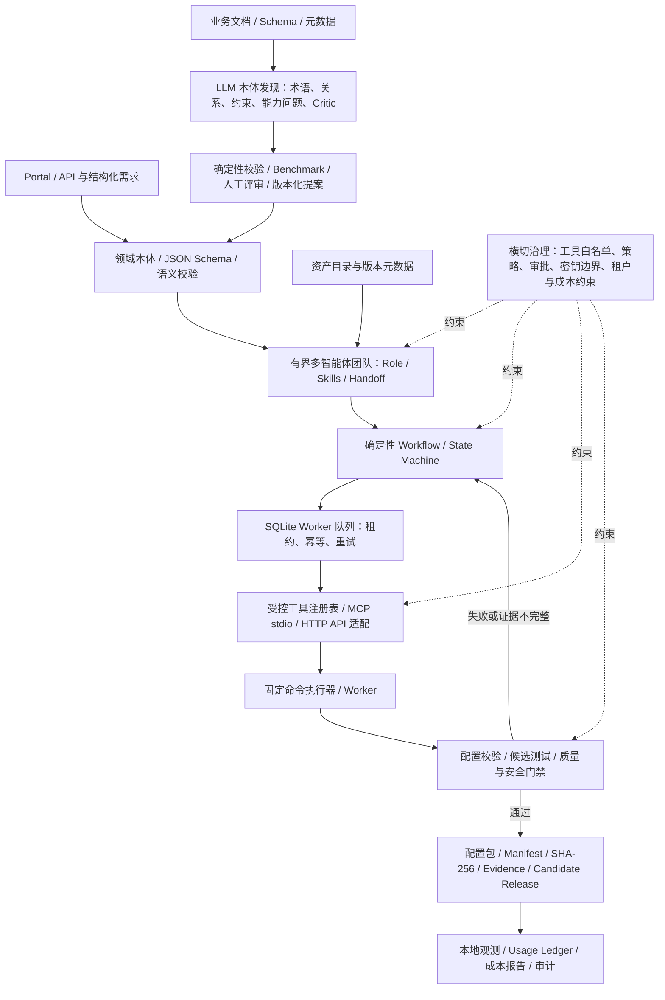

设计上的重要分工：

- **本体与契约**定义业务对象、关系、状态和机器可检查的约束；它们不替代数据库、IAM 或策略引擎。
- **多 Agent 团队**负责专业化推理、候选产物生成、任务交接和独立复核。
- **Workflow / State Machine**是任务顺序与权威状态的确定性控制器；Agent 不能自行跳过状态、批准自己的高风险动作或直接改变权威状态。
- **工具、Runner 与 Worker**执行被允许的动作，并留下退出码、日志、摘要和结构化证据。
- **质量门禁**按策略判断证据是否足以放行；缺少生产要求的证据时采取 fail-closed。
- **LLM 本体发现**只生成候选，不直接覆盖正式本体、Schema、IAM 或发布策略。

## 主要功能

| 功能域 | 主要实现 | 当前能力与边界 |
|---|---|---|
| 总体规划与架构基线 | `config/architecture-baseline.json`、`docs/architecture.md`、子系统分解、ADR、路线图 | 可校验 11 个子系统、依赖、原则、约束与阶段退出条件；规划通过不代表所有子系统均生产化。 |
| MVP 范围管理 | `config/mvp-scope.json`、`scope.py` | 校验必需模块与验收项的可追溯关系。 |
| 领域本体与契约 | `ontology/`、`contracts/schemas/`、`semantics.py` | 包含软件工厂核心实体、JSON Schema、示例对象、跨对象引用与语义规则校验。 |
| 产品资产目录 | `catalog/`、`catalog.py` | 校验产品、组件、版本、依赖、兼容约束、许可审查元数据、客户配置与租户边界；不会下载资产或验证远端二进制签名。 |
| Agent / Skills 契约 | `agents/roles/`、`skills/`、`agent_contracts.py` | 角色、Skill、工具白名单、上下文范围、输入输出契约和权限矩阵可机器校验。 |
| 多智能体协作 | `agents/teams/`、`agent-handoff.schema.json`、`multi_agent_architecture.py` | 定义团队拓扑、交接字段、并行独立验证、汇合条件、失败路径及有界修复循环；团队配置校验不等同于生产级 IAM。 |
| 工作流与状态机 | `workflows/definitions/`、`workflow_engine.py`、`workflow_store.py` | 软件交付、Agent 提案和本体发现评审三类流程；支持本地状态持久化、审批、暂停/恢复、重试和事件记录。 |
| Worker 任务队列 | `task_runtime.py`、`integration.py` | SQLite 队列、幂等键、租约/心跳、有限重试、超时、证据契约、Outbox/Inbox、重复事件处理和工作流状态回写。 |
| 工具适配 | `tool_registry.py`、`adapters/`、`tools/` | 默认拒绝的本地工具注册、HTTP JSON 与 MCP stdio 适配；外部服务连接需配置，当前 MCP 以 fixture 测试为主。 |
| 配置生产流水线 | `production_pipeline.py`、`scripts/run_software_factory_pipeline.py` | 校验需求、选择演示目录元数据、渲染 Kafka 风格配置、运行固定校验器和候选测试程序、生成配置包及构建记录。不是 Kafka 二进制构建。 |
| 质量与安全门禁 | `quality_gate.py`、`policies/quality/quality-gate-policy.json` | 检查配置结构、目录元数据、秘密模式和文件完整性；生产配置要求 Trivy/Gitleaks 真实报告，缺失时为 incomplete/blocked。当前扫描范围仅限候选配置目录。 |
| 版本化交付与回滚演练 | `release_manager.py`、`scripts/create_release.py`、`scripts/rehearse_upgrade.py` | 质量门禁通过后生成配置候选包、manifest、SHA-256 和配置包范围的 CycloneDX SBOM；升级/回滚只模拟本地状态。 |
| 观测与成本 | `observability.py`、`observability/` | 汇总本地运行/Gate 数据、LLM usage ledger；没有价格表时成本保留 `null`，不虚构费用。 |
| LLM Provider | `llm_provider.py` | 统一封装 OpenAI Responses API、结构化输出、有限重试、延迟/Token 使用记录，并提供 Fake Provider 测试。 |
| Agent Runtime | `agent_runtime.py`、`agent_workflow.py`、`ontology_runtime.py` | 可选接入 OpenAI Agents SDK；每次真实执行必须绑定已审批的完整本体快照与 SHA-256；现已接入每 Run 独立工作区、workspace.read、repository.branch.write、architecture.plan.write、固定 tests.run 和 security.scan；候选写入不会修改源仓库，不创建/推送 Git 分支；测试和扫描默认关闭宿主机执行，需操作员显式开启。Evidence 记录本体版本、工具报告和摘要。真实调用需 SDK、API Key、网络和可用模型。 |
| LLM 本体发现 | `ontology_discovery.py`、`ontology_discovery_worker.py`、`adapters/nvidia_auto_ontology.py`、`adapters/cognee_ontology.py` | 四阶段候选生成、来源引用核验、独立 Critic、Benchmark、摘要绑定审批；NVIDIA 元数据适配器只读，Cognee 输出候选暂存，不直接发布正式本体。 |

## 多智能体与本体自动发现

### 软件工厂 Agent 团队

角色定义示例包括需求分析、架构设计、实现、测试、安全审查、发布协调、运维支持、本体发现和本体 Critic。角色与 Skill 是可版本化配置；工作流文件定义任务顺序和审批点。多智能体的目标不是增加 Agent 数量，而是明确职责、限制权限、减少冲突，并让独立工具验证模型产物。

主要配置：

- `agents/roles/`：角色责任、输入输出、允许/禁止动作。
- `skills/`：任务执行方法、输入输出契约、验证和失败规则。
- `agents/teams/software-factory-mvp.json`：软件工厂团队拓扑与交接边界。
- `workflows/definitions/agent-proposal-v1.json`：需求分析、架构提案、实现提案、测试策略、安全审查与人工复核。
- `workflows/definitions/software-delivery-v1.json`：软件交付各阶段及发布审批。

### LLM 辅助本体发现

发现流水线分为四阶段：

1. **术语发现**：候选类、属性、事件、动作、状态和别名。
2. **关系发现**：有向关系、主体/谓词/客体与逐条来源引用。
3. **约束与能力问题**：业务不变量、结构约束和 Competency Questions。
4. **独立 Critic**：发现重叠、歧义、无证据关系和建模反例。

随后由确定性校验器检查 Schema、来源引用、关系端点、重复项和 Benchmark 指标。所有结果都保留在候选态，并要求领域人员审核；**LLM 的自评置信度或 Benchmark 分数不会自动授予发布权**。

可选组件的边界：

- **NVIDIA Auto Ontology**：当前适配器以只读方式导入其语义目录元数据，供本地候选发现参考；没有在本项目环境中验证真实服务连接。
- **Cognee**：当前适配器用于将候选映射到图式暂存数据集，不负责将候选提升为正式本体。
- **LLMs4OL / OLLM**：作为本体学习任务和评测参考，不是运行时必需依赖。

## 项目结构

```text
ontology-software-factory/
├── README.md
├── config/                   # 总体架构基线、MVP 范围
├── ontology/                 # 正式领域词汇、发现策略与候选 Schema
├── contracts/                # 领域、Agent、Worker、Workflow、事件 Schema
├── catalog/                  # 资产目录、版本、依赖、兼容性与元数据策略
├── agents/roles/             # Agent 角色定义
├── agents/teams/             # 多 Agent 与本体发现团队拓扑
├── skills/                   # 版本化 Skills
├── workflows/definitions/    # 软件交付、Agent 提案、本体发现工作流
├── tools/                    # 受控工具契约/实现
├── adapters/                 # HTTP JSON、MCP stdio、NVIDIA、Cognee 适配
├── runners/                  # 受限命令执行器
├── policies/                 # 工具权限、上下文与质量门禁策略
├── examples/                 # Kafka 配置、请求、交接、发现 Benchmark 与 Fixture
├── src/ontology_software_factory/ # 核心运行库
├── scripts/                  # 校验器、演示、连接检查、交付与观测 CLI
├── apps/                     # 本地 Web 控制台
├── tests/                    # 单元、契约、负向和集成测试
├── docs/                     # 架构、ADR、风险、验收与运行手册
├── article/                  # 第 15–24 篇正式文章及工程补充篇
├── observability/            # 指标与模型费率配置样例
├── deliverables/             # 本地候选交付物（运行时生成）
└── .local-runs/               # 本地运行记录与证据（运行时生成）
```

## 快速开始

### 1. 环境要求

- Python 3.11 或更新版本。
- 安装基础项目依赖后，可运行 Schema、目录、工作流、流水线和离线本体发现校验。
- 真实 LLM / Agent Runtime 需额外安装可选依赖、设置 API Key，并有网络和模型访问权限。
- `.env.example` 仅作为变量模板；项目不自动加载 `.env` 文件。请在 shell、受控的本地密钥管理器或运行环境中设置变量，切勿提交真实密钥。

### 2. 安装与验证

在仓库根目录执行：

```bash
python -m pip install -e .
make validate
make test
make docker-test-image
```

`make validate` 会校验架构基线、MVP 范围、领域契约、资产目录、Agent/Skills、多智能体拓扑、Workflow 定义、本体发现配置、连接器目录，以及 Agent Role、Skill、Workflow、Tool 和 JSON Schema 契约对本体类的引用。`make test` 运行完整 unittest 套件。测试中使用的 Fake Provider、fixture 和模拟服务用于验证本地逻辑，不代表外部 LLM/MCP/NVIDIA/Cognee 服务已经连通。

测试数量和执行结果以当前提交对应的 GitHub Actions CI 为准。离线 Fixture、Fake Provider 和模拟集成测试不等于真实外部服务或生产环境验收。

### 3. 一键演示配置交付

```bash
make demo-e2e
```

或使用独立运行 ID，避免与旧的本地运行目录冲突：

```bash
python scripts/run_e2e_delivery.py \
  --request examples/requests/kafka-development.json \
  --runs-root .local-runs \
  --deliverables deliverables \
  --run-id local-demo-001
```

该链路会：校验结构化需求 → 读取演示资产目录 → 渲染配置 → 运行配置校验器与候选测试 → 打包配置文件 → 生成质量门禁报告 → Gate 通过时产生候选交付物。默认不会部署。

批准的本地升级/回滚演练（不连接真实集群）：

```bash
python scripts/run_e2e_delivery.py \
  --request examples/requests/kafka-development.json \
  --runs-root .local-runs \
  --deliverables deliverables \
  --run-id local-rehearsal-001 \
  --approved-by local-reviewer \
  --approval-reason "本地演练"
```

验证回滚分支时增加 `--simulate-health-failure`。演练只更新本地 JSON 状态，不触达 Kafka 或外部环境。

### 4. 生产配置的负向门禁演示

```bash
python scripts/run_software_factory_pipeline.py \
  --request examples/requests/kafka-production.json \
  --output-root .local-runs \
  --run-id production-gate-demo

python scripts/run_quality_gate.py --run-dir .local-runs/production-gate-demo
```

若生产策略要求的 Trivy/Gitleaks 实际执行报告缺失，Gate 应返回 `incomplete` 或阻断且 `releaseAllowed=false`。这是预期行为，不应通过伪造报告绕过。

### 5. 离线演示本体发现

```bash
make demo-ontology-discovery
make demo-ontology-discovery-worker
```

两条命令使用本地 Fixture，不请求外部模型。候选文件写入 `.local-runs/ontology-candidates/` 或相应 Worker 演示目录，候选状态仍需人工审核。

### 6. 观测报告

```bash
make observability
```

默认汇总 `.local-runs` 中的运行数据，并依据 `observability/config/model-rates.example.json` 核算可识别的 LLM 使用成本。若缺少费率或 Usage 数据，成本应保留为空值/未知，而不是推算一个看似精确的数字。

## 主要演示与运行命令

| 命令 | 用途 |
|---|---|
| `make validate` | 执行设计、范围、本体、目录、Agent、Workflow 和发现配置校验。 |
| `make test` | 运行完整单元与集成测试。 |
| `make demo-pipeline` | 运行本地配置生成、校验、候选测试和打包流程。 |
| `make demo-gate` | 对示例运行记录执行质量门禁。 |
| `make demo-e2e` | 运行配置交付、质量 Gate 和候选发布流程。 |
| `make demo-ontology-discovery` | 用离线 Fixture 生成并校验本体候选。 |
| `make demo-ontology-discovery-worker` | 通过 Worker 队列演示本体发现及证据回写。 |
| `make observability` | 生成本地运行/成本观测报告。 |
| `make portal` | 启动统一软件工厂 Portal（默认 `127.0.0.1:8770`）。 |
| `make llm-check` | 使用当前 shell 的 API Key 检查 OpenAI Responses API 连通性。 |
| `make ai-runtime-console` | 启动 LLM / Agent Runtime Console（默认 `127.0.0.1:8768`）。 |
| `make agent-workflow-console` | 启动绑定活动本体快照的真实多 Agent Workflow Console（默认 `127.0.0.1:8769`）。 |
| `make clean-local` | 删除 `.local-runs`、`.local-environments`、`.local-portal`、`deliverables` 和观测报告。请先备份需要保留的演示数据。 |

常用脚本的具体参数可通过 `python scripts/<script>.py --help` 查看。

## 安装、依赖与运行手册

新增三份面向开发和部署交接的完整文档：

- [安装指南](docs/installation.md)：Python 环境、虚拟环境、基础安装、可选 extras、外部工具安装和首次启动。
- [依赖工具与组件清单](docs/dependency-inventory.md)：基础 Python 包、OpenAI Agents SDK、PostgreSQL/MySQL 驱动、Semgrep/Gitleaks/Trivy、Git、MCP、Cognee、NVIDIA 和所需外部服务。
- [本体版本绑定与 Agent Runtime 运行手册](docs/ontology-runtime-version-binding.md)：活动版本初始化、审批发布、Runtime 启动、任务执行、证据核验和故障排查。
- [受控工作区、测试执行与安全扫描](docs/controlled-workspace-execution.md)：Agent 候选文件操作、固定测试套件、扫描器开关、报告摘要和执行安全边界。
- [本次发布说明](docs/releases/2026-10-30-ontology-bound-agent-runtime.md)：实现范围、安装升级、首次运行前置条件和验收边界。

最小安装仍然是 `python -m pip install -e .`。真实多 Agent Runtime 额外安装 `python -m pip install -e '.[agent-runtime]'`；PostgreSQL / MySQL 连接器分别安装 `.[postgres]` / `.[mysql]`。本项目静态前端不需要 Node.js / npm。不要为了未启用的外部集成安装全部组件。

真实 Agent Workflow 必须先在 Portal 中创建本体快照并完成独立 promote 审批。运行时会把活动快照 ID、摘要、Ontology Version 和 Schema Version 固定到 Workflow Run、Agent Task、Agent Result 与 Evidence；没有活动版本或摘要校验失败时会拒绝执行。

## 本地 Web 控制台

控制台默认绑定 `127.0.0.1`。它们是无认证的开发演示界面，只能在可信本机环境中运行，不要直接暴露到局域网或公网。

| 控制台 | 启动命令 | 默认地址 | 用途 |
|---|---|---|---|
| Workflow Console | `python scripts/run_workflow_console.py` | `http://127.0.0.1:8765` | 工作流运行、节点状态、审批与事件时间线演示。 |
| Worker Console | `python scripts/run_worker_console.py` | `http://127.0.0.1:8766` | 本地任务队列、幂等提交、执行一次 Worker 和证据查询；只允许两个 Demo Handler。 |
| Integrated Console | `python scripts/run_integrated_console.py` | `http://127.0.0.1:8767` | 统一查看任务、Worker、Outbox/Inbox 及工作流回写。 |
| AI Runtime Console | `python scripts/run_ai_runtime_console.py` | `http://127.0.0.1:8768` | 检查真实 LLM 连接并运行 Agent 提案流水线；需要真实模型凭据和可选依赖。 |
| Agent Workflow Console | `python scripts/run_agent_workflow_console.py` | `http://127.0.0.1:8769` | 持久化多 Agent 工作流、Worker 任务派发、Relay 回写和人工复核；需要真实 Agent Runtime 依赖与模型凭据。 |

可通过 `--host`、`--port` 和 `--db` 参数调整地址或本地 SQLite 文件位置；非回环绑定前必须自行添加身份认证、授权、网络控制与数据保护措施。

## 四阶段统一平台 Portal

在既有代码上新增统一的深色可视化操作台，整合企业资产、本体、Agent、质量安全和交付发布模块。启动方式：

```bash
make portal
# 浏览器访问 http://127.0.0.1:8770
```

| 功能模块 | 当前实现 | 重要边界 |
|---|---|---|
| 平台基础 | 统一导航、REST API、稳定对象 ID、本地状态与事件账本、同源写操作校验 | 本地 JSON 状态；无企业登录、多租户 IAM 或不可篡改审计存储 |
| 企业资产接入与本体工作台 | 目录/文档/SQLite/PostgreSQL/MySQL Schema 只读扫描、本地 Git 元数据、GitHub.com/GitLab.com HTTPS 仓库元数据只读 API、交互式 SVG 关系图、候选证据卡片与文件浏览链接、同步历史/错误分类、候选证据有效性与影响术语计数 | 没有 OAuth/SSO、自托管 GitLab 或 Webhook；远端候选仅依据文件路径和 tree revision，本地候选使用规则抽取且不调用 LLM；数据库只读取 information_schema；证据状态依赖最近扫描而非实时监听；审批不自动修改正式本体 |
| Agent 与质量安全 | 离线 Agent 阶段状态机、事件证据、真实校验脚本/测试套件、可选 Semgrep/Gitleaks/Trivy 扫描器检查 | 离线 Agent 不调用真实模型；扫描器缺失/未执行不能显示 PASS；非容器隔离测试床 |
| 交付发布 | 触发现有端到端流水线，显示配置包 manifest、哈希、配置范围 SBOM、独立审批和本地升级/回退演练 | 不包含 Kafka 二进制，不部署真实环境；SBOM 只描述配置交付包 |

私有远端仓库需要在同一个 shell 中设置环境变量后再执行 `make portal`：`export GITHUB_TOKEN=...` 或 `export GITLAB_TOKEN=...`。门户源代码在 `apps/factory-portal/`，服务端入口在 `scripts/run_factory_portal.py`，详细阶段、接口和验收边界见 [`docs/platform/four-stage-platform-delivery.md`](docs/platform/four-stage-platform-delivery.md)，实施与验证记录见 [`docs/platform/four-stage-implementation-report.md`](docs/platform/four-stage-implementation-report.md)。首次运行时会在 `.local-portal/` 创建本地 JSON 状态和合成 SQLite 数据库；该目录已忽略，不应提交。可接入已有本机代码/文档目录或 SQLite 数据库，请谨慎配置路径。

**安全说明：** Portal 默认只绑定 `127.0.0.1` 且不带登录认证。不要直接暴露到局域网或公网。目录连接器只扫描限定扩展名并跳过隐藏目录、依赖目录和大文件；SQLite/PostgreSQL/MySQL 使用只读 Schema 查询。数据库连接配置只保存 DSN 环境变量名和显式主机 allow-list，不保存 DSN 值；主机 allow-list 不是网络出口防火墙。GitHub/GitLab 文件链接仅打开托管平台浏览器页面。同步历史保存在本地可修改的 JSON 状态文件，不是不可篡改审计日志。生产部署仍需企业身份认证、角色授权、服务端数据存储、外部系统凭据管理、网络出口控制、隔离执行器和正式安全评审。

## 界面截图

下面包含现有控制台截图，以及基于本体发现 CLI/Worker 实际运行产物生成的审查视图。所有离线 Fixture 数据都在截图中明确标注；不把它们表述成真实 LLM 推理或生产执行结果。

| 工作流总览与治理 | 失败节点与重试策略 |
|---|---|
| <a href="docs/screenshots/01-workflow-console-overview.png">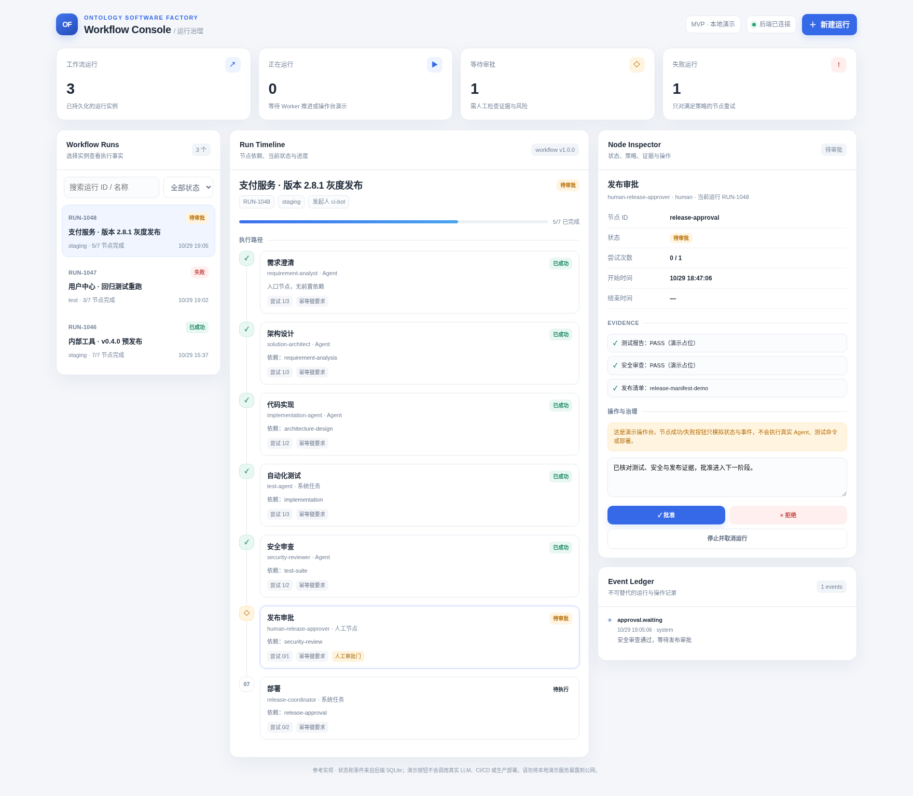</a> | <a href="docs/screenshots/02-workflow-console-failed-retry.png">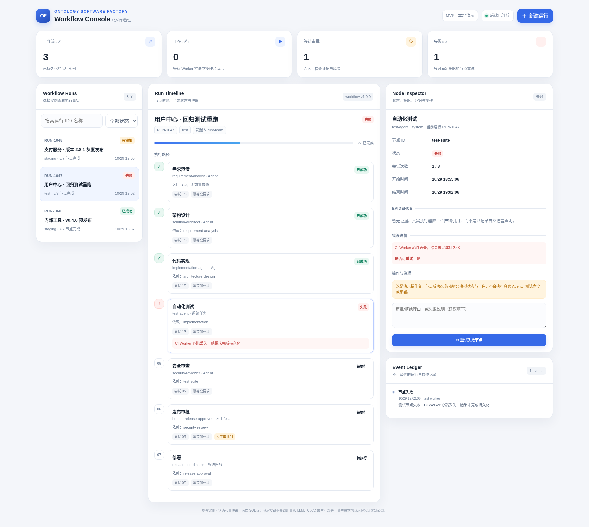</a> |
| Worker 任务与执行证据 | Workflow—Worker—Outbox 执行闭环 |
| <a href="docs/screenshots/03-worker-runtime-evidence.png">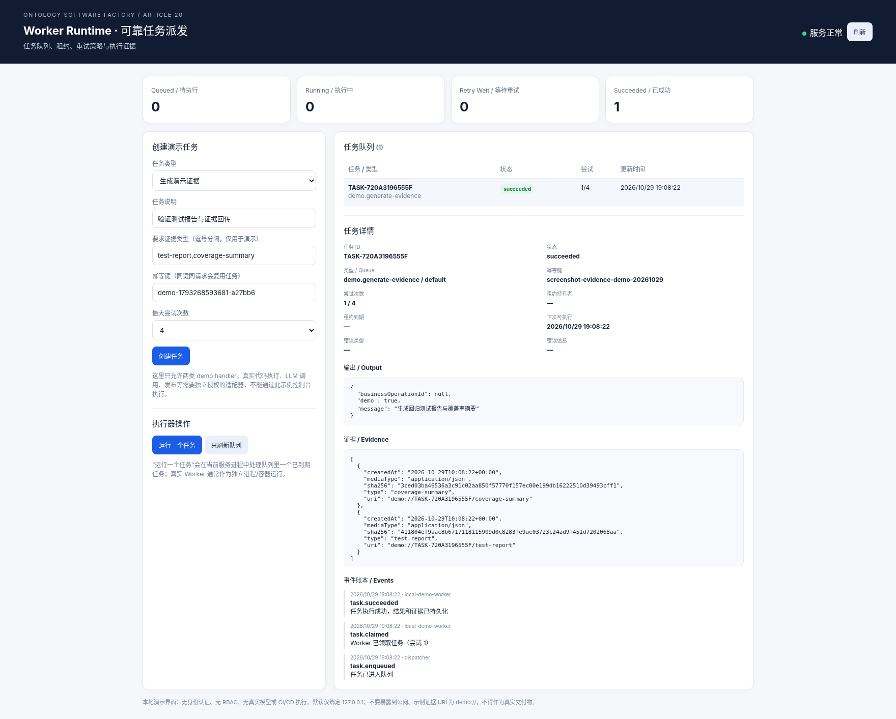</a> | <a href="docs/screenshots/04-integrated-closed-loop.png">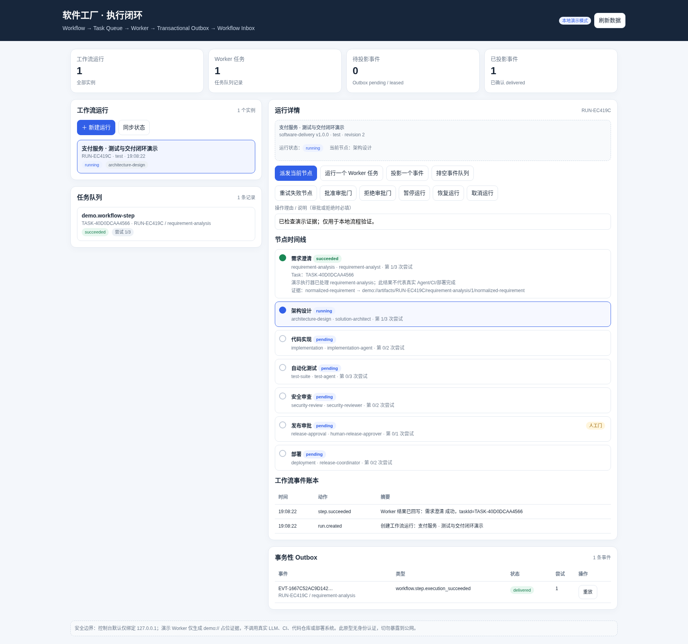</a> |
| LLM / Agent Runtime 环境检查 | 本体发现与候选验证流水线 |
| <a href="docs/screenshots/05-ai-runtime-readiness.png">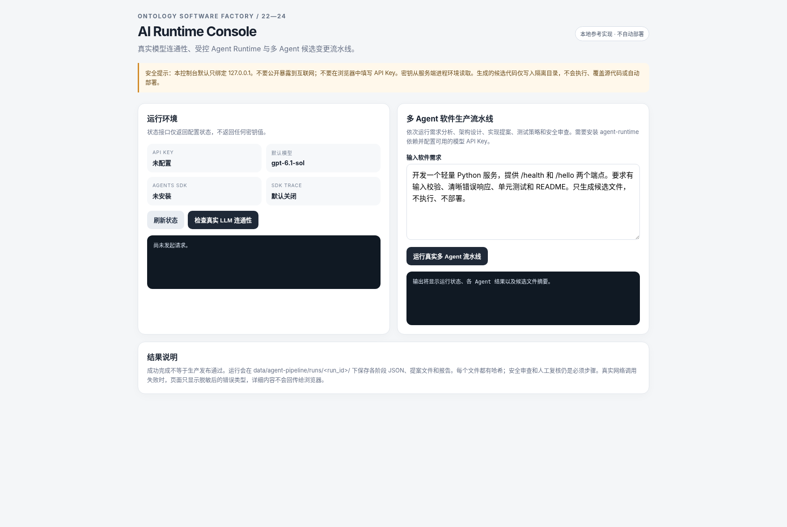</a> | <a href="docs/screenshots/06-ontology-discovery-pipeline.png">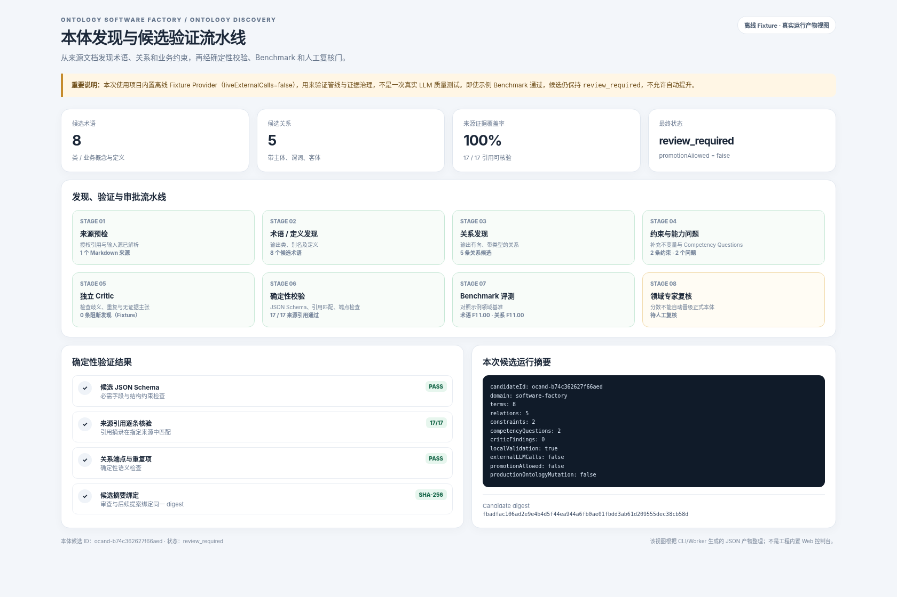</a> |
| 本体定义：术语、关系与约束 | 本体发现 Worker 与证据链 |
| <a href="docs/screenshots/07-ontology-definition-review.png">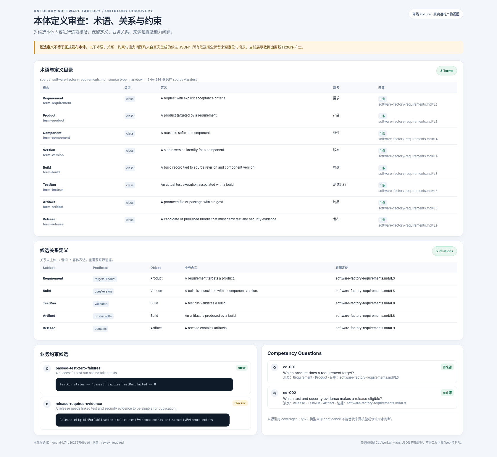</a> | <a href="docs/screenshots/09-ontology-worker-evidence.png">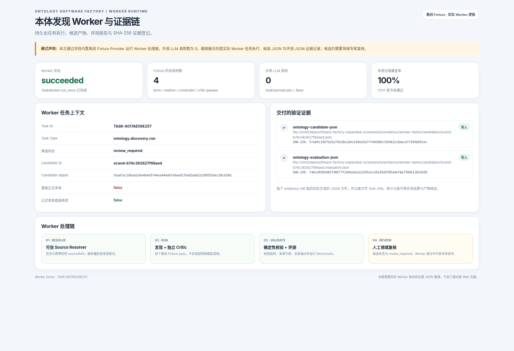</a> |
| 本体维护：摘要绑定审批与版本化变更 | 多智能体工作流运行 |
| <a href="docs/screenshots/08-ontology-maintenance-approval.png">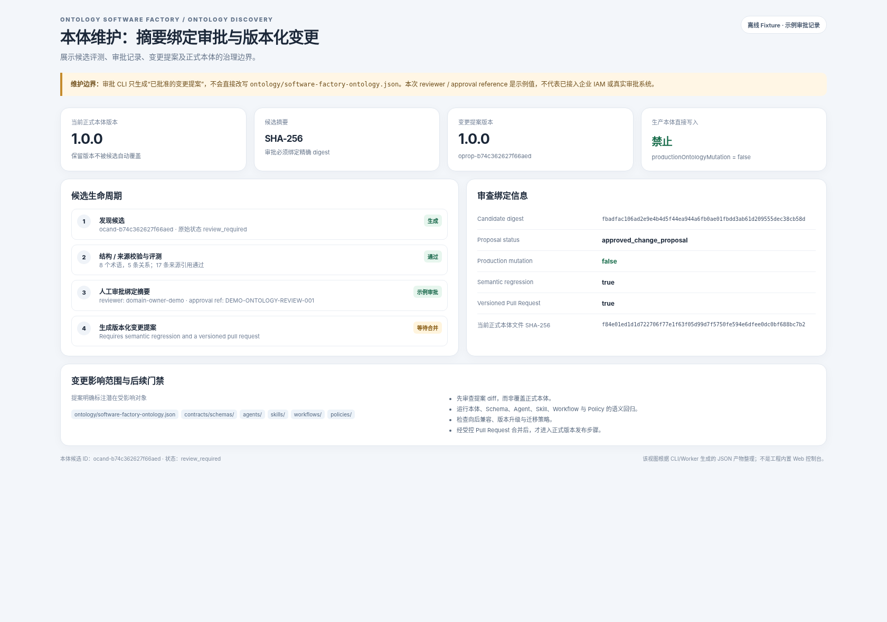</a> | <a href="docs/screenshots/10-multi-agent-workflow-human-review.png">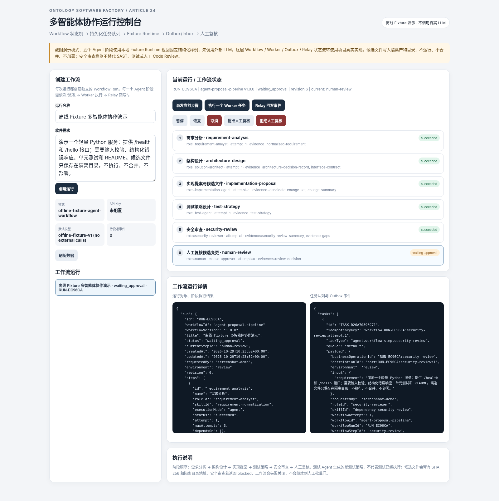</a> |
| 多智能体任务队列与 Outbox 事件 | 全部截图缩略总览 |
| <a href="docs/screenshots/11-multi-agent-worker-outbox-evidence.png">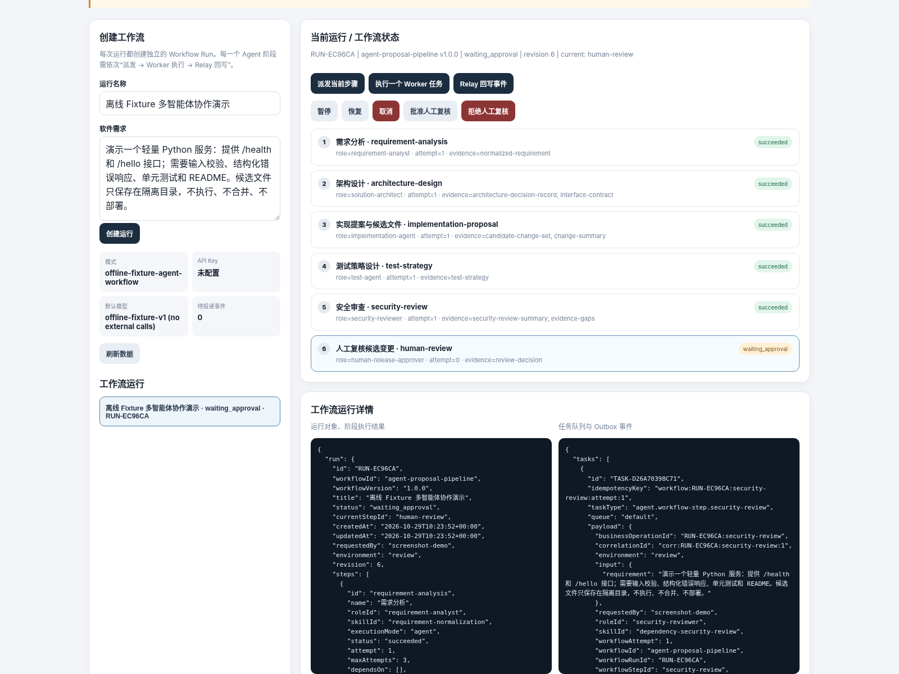</a> | <a href="docs/screenshots/00-contact-sheet.png">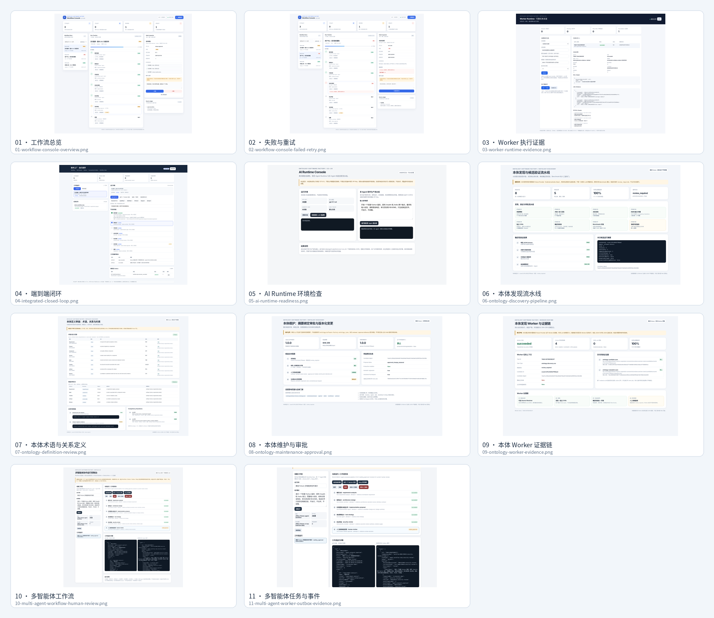</a> |

**阅读边界：** `01–05` 是此前已有控制台截图；`06–09` 是根据真实 CLI/Worker 输出 JSON 整理的说明性审查视图；`10–11` 使用现有 Agent Workflow Console 前端与实际 Workflow/Worker/Outbox 状态流转，但采用 Fixture Runtime。新增统一 Portal 可通过 `make portal` 在本机运行，本次代码交付尚未附新的浏览器截图。示例 Benchmark 的 F1 指标不能外推为真实模型质量，候选仍须经领域专家复核。细节见 [`docs/screenshots/README.md`](docs/screenshots/README.md) 和 [`docs/platform/four-stage-platform-delivery.md`](docs/platform/four-stage-platform-delivery.md)。

## 真实 LLM 与 Agent Runtime（可选）

### 安装可选依赖

```bash
python -m pip install -e '.[llm,agent-runtime]'
```

在当前 shell 或秘密管理环境中设置真实凭据：

```bash
export OPENAI_API_KEY='你的 API Key'
export OPENAI_MODEL='你的账户可用模型 ID'
export AGENT_TRACE_ENABLED=false
```

`OPENAI_MODEL` 的示例默认值不保证对所有账户可用；请使用你实际有权限访问的模型。不要将 API Key 写入代码、示例 JSON、任务载荷或 Git。默认关闭 Agents SDK tracing；启用 tracing 前先审查其数据处理与留存设置。

先做一条真实 API 连接检查：

```bash
python scripts/check_llm_connection.py
```

真实本体发现示例（指定非敏感文档）：

```bash
python scripts/run_ontology_discovery.py \
  --domain software-factory \
  --source docs/architecture.md \
  --source docs/domain-model.md \
  --output-root .local-runs/ontology-candidates
```

可按阶段设置 `ONTOLOGY_TERM_MODEL`、`ONTOLOGY_RELATION_MODEL`、`ONTOLOGY_CONSTRAINT_MODEL` 和 `ONTOLOGY_CRITIC_MODEL`；未配置时回退到 `OPENAI_MODEL`。这会把指定源文本发送给模型服务。处理客户数据前，应先确认数据分类、脱敏、区域和保留政策。

成功调用模型只证明 API 可用，不证明生成结果正确；本体候选仍须通过来源引用检查、独立 Critic、领域 Benchmark 与人工评审。

## 安全边界与当前限制

1. **演示目录是合成元数据。** 版本和制品摘要不能用来证明真实 Kafka 二进制的来源、许可证或兼容性。
2. **交付范围是配置包。** `candidate-config-bundle.tar.gz` 和对应 SBOM 只描述本例 `server.properties` 配置文件，不包含 Kafka runtime。
3. **执行器不是 OS 级沙箱。** Agent 每个 Workflow Run 使用独立仓库副本；候选文件写入不会修改源 checkout。测试执行和安全扫描默认关闭，显式开启后仍是宿主机进程；固定命令、参数数组、`shell=False` 和超时限制不能替代容器/微虚机隔离、网络策略、只读挂载和短期凭证。
4. **生产安全扫描尚需外部工具。** Trivy/Gitleaks 仅在检测到并能够运行时生成报告；当前策略覆盖候选配置目录，不等同源代码 SAST、完整依赖 SCA 或 Kafka 镜像/二进制扫描。缺少强制证据时应阻断。
5. **生产身份和审批系统未接入。** 本地角色权限与模拟审批不是企业 IAM、审批单系统或可抵赖性审计服务。
6. **MCP/NVIDIA/Cognee 的真实服务未在本项目环境验收。** 本地 fixture 通过不能代表外部实例已连通；NVIDIA 适配器当前只读，Cognee 适配器使用候选暂存区。
7. **真实 LLM 需单独验证。** 没有 API Key、网络、可用模型及 SDK 时，只有 Fake Provider 测试；不得声称完成真实端到端模型验收。
8. **发布与回滚是本地演练。** 不会操作真实 Kafka、Kubernetes 或客户环境；数据库迁移等不可逆操作也不在现有演示范围。
9. **观测不是生产遥测后端。** 当前以本地 JSON/JSONL 记录为主，不提供多租户账单、企业指标平台或完整审计存储。
10. **设计资产验证不等于生产就绪。** 通过 `make validate` 表示定义和引用一致，不代表所有架构子系统已经实现。

## S4–S8 下一阶段实施验收基线

为避免把已有参考实现误判为生产级能力，下一阶段的硬化目标与验收条件单独维护：

- [S4 多智能体运行时硬化](docs/implementation/s4-agent-runtime-hardening.md)：策略授权、上下文最小化、结构化输出、交接重放、独立验证与预算停止。
- [S5 Workflow / State Machine 硬化](docs/implementation/s5-workflow-state-machine-hardening.md)：并行 readiness/join、租约与 attempt fencing、审批绑定、暂停恢复、取消补偿和事件重放。
- [S6–S8 工具、Runner 与质量证据硬化](docs/implementation/s6-s8-tools-runner-quality-evidence.md)：工具契约、受限执行、MCP/HTTP 权限边界、候选摘要绑定和 fail-closed Gate。

这三份文档是下一阶段的实施验收基线，不代表其中列出的所有目标能力已经完成。实际完成情况应以对应代码、测试和外部集成验收结果为准。

## 验收与进一步阅读

建议按以下顺序阅读项目文档：

1. `docs/project-charter.md`、`docs/scope-and-nongoals.md`：建设范围和非目标。
2. `docs/architecture.md`、`docs/subsystem-decomposition.md`、`docs/development-roadmap.md`：总体架构、模块边界和开发阶段。
3. `docs/domain-model.md`、`docs/ontology-design-and-evolution.md`：领域语义、契约和本体生命周期。
4. `docs/multi-agent-architecture.md`、`docs/agent-roles-and-skills.md`：团队拓扑、角色、Skill 和交接。
5. `docs/workflow-orchestration.md`、`docs/worker-runtime-and-reliable-dispatch.md`、`docs/workflow-execution-closed-loop.md`：任务编排、Worker 和事件闭环。
6. `docs/ontology-discovery.md`、`docs/ontology-discovery-evaluation.md`：LLM 本体发现、来源证据和评测。
7. `docs/tool-adapters-and-security-execution.md`、`docs/acceptance/mvp-v2-acceptance.md`：工具边界、真实验收状态和未完成项。
8. `docs/adr/`：关键架构决策记录。
9. `article/`：第 15–24 篇正式公众号稿，以及 `article/supplementary/` 下此前完成的工程补充篇 A–E。

本轮 Portal 证据导航与连接器运行状态实现说明见 [Evidence Navigation and Connector Operations Console](docs/2026-10-30-evidence-navigation-and-connector-console.md)。

本轮证据生命周期与真实数据库联调测试说明见 [Ontology Evidence Lifecycle and Live Database Checks](docs/2026-10-30-evidence-lifecycle-and-live-db-checks.md)。

本轮本体版本快照、结构差异与影响分析说明见 [Ontology Versioning and Impact Analysis](docs/2026-10-30-ontology-versioning-and-impact-analysis.md)。

本轮消费者依赖图、兼容性门禁与受控版本治理说明见 [Ontology Dependency and Governance](docs/2026-10-30-ontology-dependency-and-governance.md)。

本轮 Agent Runtime 本体版本绑定、安装和运行说明见 [Ontology Runtime Version Binding](docs/ontology-runtime-version-binding.md)，安装与可选组件清单见 [Installation](docs/installation.md) 和 [Dependency Inventory](docs/dependency-inventory.md)。

`make validate` 现额外执行 `scripts/validate_ontology_consumers.py`，验证 Agent Role、Skill、Workflow、Tool 和契约中的本体引用。

**验收原则：** 只有当真实执行结果、退出码、日志、摘要与必需证据齐全时，才将相应任务标记为 `PASS`。模型生成的自然语言总结、fixture 结果或设计文档本身，都不能替代真实构建、测试、安全扫描和部署证据。


本阶段 Agent 受控工作区、Run 级 Role/Skill 锁、Docker 固定测试执行和 Git Worktree 本地候选分支说明见 [controlled workspace execution](docs/controlled-workspace-execution.md)。


本阶段进一步加入 Run 级 Workflow/Role/Skill 内容锁、Docker 固定测试执行、digest 固定的容器安全扫描与 Agent Workspace 证据门禁；Git Worktree 仅创建本地候选分支，不自动 push/PR/merge。详见 [受控工作区与执行手册](docs/controlled-workspace-execution.md)。


## 连接器平台与本体数据接入

连接器分为两条独立能力线：**本体数据源连接器**（只读发现代码、文档、数据库 Schema、API/事件契约、数据目录和运维元数据）与 **Agent 动作连接器**（受控创建 PR、更新工单、触发 CI 等写操作）。两者共享注册、权限、凭据引用、审计和版本治理，但不共享写权限。

当前新增连接器描述目录、Schema、默认拒绝授权检查和校验命令：

- `connectors/registry.json`：连接器能力、方向、操作、实现状态、数据分类、认证方式和网络出口声明。
- `src/ontology_software_factory/connector_catalog.py`：加载并校验连接器目录；仅允许已实现且明确声明的操作，未知/未实现连接器默认拒绝。
- `make connector-catalog`：单独校验连接器目录；`make validate` 已纳入该检查。
- [连接器平台与本体数据接入设计](docs/connector-platform-and-ontology-ingestion.md)：覆盖 Harness、Skills、Tools、连接器边界与数据源路线图。

目录中标记为 `planned` 或 `adapter-required` 的项目只是能力路线图，不能被运行时调用。当前未因此新增 Confluence、SharePoint、Google Drive、Kafka Schema Registry、GraphQL 等真实外部适配器，也未实现生产级 OAuth/Secret Broker。


## Harness、Skill Registry 与连接器运行时

本阶段增加了三项本地参考运行组件，并扩展只读 Agent 工具：

- `src/ontology_software_factory/harness.py`：按角色字段白名单装配上下文，校验租户/项目绑定，限制工具调用和模型 Token 预算，支持审批校验回调、元数据审计和文件型 Kill Switch。
- `src/ontology_software_factory/skill_registry.py`：校验 Skill JSON Schema、角色兼容关系、所需能力 ID，并对 `skill.json` 与 `SKILL.md` 生成内容摘要锁。
- `src/ontology_software_factory/connector_runtime.py`：通过注入式只读 Source Adapter 执行扫描，检查主体/租户/连接器状态，投影来源资产元数据并写入审计事件。
- `src/ontology_software_factory/api_contract_connectors.py`：离线解析 OpenAPI JSON、AsyncAPI JSON、GraphQL SDL、Protobuf、dbt manifest/catalog 和 Schema Registry JSON 导出文件，抽取 API 操作、Schema、事件通道、消息、类型和 RPC 候选。
- Agent 工具新增 `ontology.definition.read`、`source.catalog.read`、`dependencies.inspect`，按角色白名单开放。
- Portal 的 `/api/observability` 和统一监控视图新增 Harness / Connector 审计摘要。

校验命令：

```bash
make harness
make skill-registry
make connector-catalog
make connector-runtime
make test
```

当前实现边界：Harness 尚未作为 OpenAI Agents Runtime 的默认工具中介；SkillRegistry 尚未替换 Agent Workflow 当前的 Skill 装载路径；ConnectorRuntime 尚未统一接管 Portal 全部数据源路径。API 契约解析只接受显式提供的文件，OpenAPI/AsyncAPI 当前解析 JSON，GraphQL 使用受限 SDL 解析，Protobuf 不执行 protoc 或导入解析；dbt 与 Schema Registry 连接器仅导入显式提供的 JSON 导出文件，不连接实时服务。企业 SSO、OAuth/Secret Broker、分布式预算、跨节点连接器任务、Webhook 增量同步、企业 ACL 传播和防篡改审计仍需后续建设。
