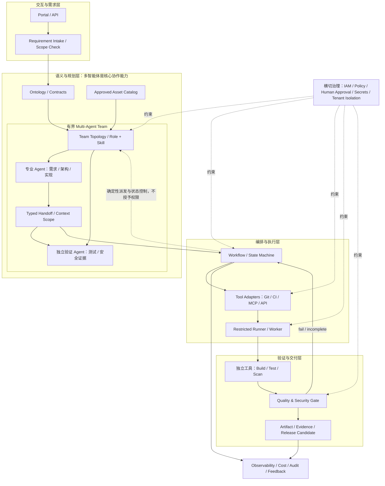
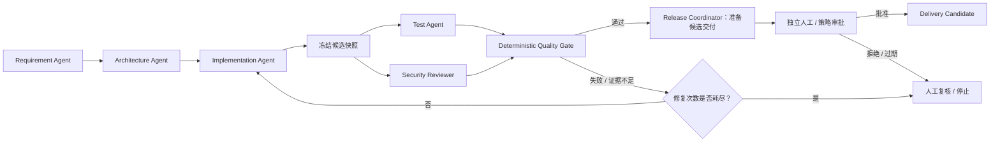
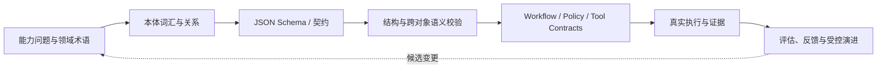

# 第 15 篇｜先规划，再编码：AI 软件工厂的总体设计、子系统分解与开发路线图

**「通往AI之桥」｜《本体论在 AI 工程中的实践》系列 · 第 15 篇**  
**实战 Part：多智能体软件工厂（第 15–24 篇）**  
建议阅读时间：18–22 分钟

> **本篇目标：** 在大规模编码开始之前，形成一份可以评审、可以追踪、可以逐步验收的软件工厂总体规划与概要设计：明确目标和边界，分解子系统、模块与组件，定义关键接口和依赖，制定架构原则与不可突破的约束，规划本体设计及其工程应用，并把开发过程拆解成可验收的阶段。
>
> 本篇保留前一版已经确认的 MVP 范围：从结构化需求和已批准资产开始，产出经真实校验、测试和质量门禁验证的候选配置/软件交付物；生产发布由独立授权和人工审批控制。首个贯穿案例仍是 Kafka 的标准化配置与客户化交付，不重写 Kafka 本身。

---

## 01 为什么第 15 篇必须先完成系统性规划？

在进入编码前，如果只定义“要做哪些功能”，通常还不够。软件工厂是一组相互依赖的能力：领域语义决定对象如何表达；资产目录决定哪些组件能够复用；Agent 和 Skills 产生候选结果；工作流决定执行顺序；工具适配器连接 Git、构建、测试和扫描平台；运行器负责在约束环境中执行；质量门禁判断是否允许进入交付；证据与观测则记录每一步究竟发生了什么。

如果这些边界没有提前设计，开发很容易走成几条互不兼容的支线：每个 Agent 定义自己的数据结构；工作流和 Worker 各自维护状态；工具输出没有统一错误语义；本体只存在于文章或图里；测试报告不能关联到代码版本；客户配置直接混进标准产品；最后不得不在后期进行高成本重构。

因此，第 15 篇不应只是创建代码目录或罗列 MVP 功能，而应成为整个实战 Part 的**设计基线（Architecture & Delivery Baseline）**。后续第 16–24 篇逐项实现这份设计，必要时通过 ADR 有记录地修订，而不是每篇重新发明一套架构。

### 本篇需要形成的设计产物

1. 项目章程：目标、用户、业务场景、范围、非目标和成功标准。
2. 总体架构：系统上下文、逻辑分层、控制面与执行面边界。
3. 子系统分解：子系统、模块、组件、职责、输入输出和依赖关系。
4. 领域本体方案：建模范围、核心概念、关系、状态、约束、版本和工程映射方式。
5. 关键契约：需求、资产、任务、工具调用、执行结果、证据、质量门禁和交付记录的边界。
6. 设计原则与硬约束：哪些决策不能由单个 Agent、模型或模块自行改变。
7. 开发路线图：阶段、依赖、退出条件、验收证据和风险。
8. 可机检的设计基线：让重要决定不仅写在文章里，还能够被脚本与测试检查。

### 配图建议 1｜先规划，再建设

**建议位置：本节之后。**

**图片生成提示词：**

> 生成一张 16:9 横版企业技术信息图，标题“先规划，再建设：AI 软件工厂设计基线”。从左到右展示业务目标与边界、总体架构、子系统分解、领域本体与契约、开发路线图、验收证据六个阶段；下方用一条贯穿全图的治理基线连接安全、版本、审批、可观测性。使用深蓝、青绿色和少量橙色，白底、留白充足、中文标签清晰，不使用虚构效率指标。强调先完成可评审的设计，再逐步实现，不表示所有模块已经上线。

## 02 项目章程：我们究竟要建设什么？

### 2.1 建设目标

建设一个以共享业务语义、批准资产和可验证交付为核心的**可组合软件工厂参考实现**。它接收结构化需求与目标环境约束，选择已批准的产品/组件资产，生成或修改配置及受控代码变更，调用真实工程工具执行验证，并将测试、安全检查、审批和交付证据关联起来。

软件工厂不是“一个更大的编码 Agent”，而是围绕软件生产过程建立的系统：模型负责理解、分析和提出候选方案；确定性组件负责校验和执行；独立门禁负责决定是否允许向下一阶段推进；人工责任角色负责批准高风险变更。

### 2.2 首个贯穿场景

首个示例选择 Kafka，但业务范围是**对批准版本的标准部署配置和客户化配置进行管理、验证与交付**。示例可以包括：

- 需求：目标环境、容量、可用性、保留策略、安全要求和验收条件；
- 资产：已批准组件版本、配置模板、兼容性说明、测试脚本和来源元数据；
- 生产：根据结构化参数渲染候选配置，在受控环境中运行配置校验和回归测试；
- 验证：根据工具实际输出形成质量门禁结果；
- 交付：生成带版本、文件摘要、验证报告和审批记录的候选交付包；
- 反馈：保存运行时延迟、失败、返工、人工介入和成本数据。

这个案例是验证工厂机制的切入点，不代表项目会下载、编译或重新发布 Kafka 上游二进制，更不代表已经完成真实 Kafka 集群的兼容性或生产部署测试。

### 2.3 用户与责任角色

| 角色 | 主要需求 | 不应拥有的默认权限 |
|---|---|---|
| 产品/交付负责人 | 提交需求、确定验收条件、查看候选交付 | 直接绕过安全门禁或批准自己提交的高风险变更 |
| 领域专家/架构师 | 维护术语、规则、资产标准和技术决策 | 在没有变更评审时静默修改已发布契约 |
| 平台工程师 | 配置工作流、工具适配和执行环境 | 将个人管理员凭证透传给 Agent |
| 测试/安全人员 | 独立验证制品并审查风险 | 只根据 Agent 的自然语言总结判定通过 |
| 发布审批人 | 审查证据、风险、部署计划和回退方式 | 在没有审计记录的情况下批准高风险动作 |
| Agent/Worker | 在明确任务、工具和权限范围内工作 | 自行提升权限、改变门禁策略或批准自己的输出 |

### 2.4 成功标准

成功不以 Agent 数量、生成代码行数或对话轮数衡量，而以可重复、可验证的结果衡量：

- 需求、资产、候选变更、测试结果、制品和发布记录之间可以追溯；
- 不合格结果能被质量门禁阻止；
- 重试、取消、审批、回滚与未知执行结果具有明确语义；
- 标准资产和客户差异不会无意形成长期分叉；
- 可以逐项记录成功率、返工、交付时延、人工介入和单位交付成本，并与人工基线比较。

## 03 保留 MVP：先跑通一条可验证生产路径

### MVP 纳入范围

1. 结构化需求记录，包含稳定 ID、来源、目标环境、范围和验收条件。
2. 资产目录中已批准且版本明确的组件和模板选择。
3. 客户化配置的机器可执行校验。
4. 受控执行环境中的真实配置验证、构建/测试工具调用及日志采集。
5. 基于实际工具输出的质量与安全门禁，门禁失败必须阻止发布。
6. 将源码/配置版本、运行 ID、测试结果、制品摘要和证据关联起来。
7. 版本化候选交付包、变更记录和人工审批。
8. 最小运行观测：状态、耗时、错误、人工介入与可用的成本数据。

### MVP 明确不做

- 从零重写 Kafka 或其他成熟中间件；
- 不受限地自主开发任意语言、任意架构、任意规模的软件；
- Agent 直接持有生产管理员凭证，或任意执行 shell/网络操作；
- 没有审批的生产部署、破坏性变更、数据迁移和密钥操作；
- 替代现有 Git、CI/CD、测试、安全扫描、制品库和部署平台；
- 在问题没有证明之前，引入复杂的全局知识图谱或形式化推理平台；
- 将模型生成的文字报告当作真实执行证据。

### MVP 的验收不是“看起来跑通”

| 验收 ID | 验收目标 | 必须留下的证据 |
|---|---|---|
| MVP-01 | 需求有稳定 ID、来源和范围 | 请求记录及 Schema 校验结果 |
| MVP-02 | 只使用批准且版本明确的资产 | 资产选择记录及拒绝未批准资产的负向测试 |
| MVP-03 | 配置先校验再执行 | 有效/无效配置样例及工具输出 |
| MVP-04 | 验证任务由受控运行器实际执行 | 运行 ID、命令、退出码和日志摘要 |
| MVP-05 | 测试绑定到候选版本和制品 | 版本/提交、测试运行、制品摘要之间的关联 |
| MVP-06 | 门禁失败时不允许发布 | 注入失败测试/安全发现并证明发布被阻断 |
| MVP-07 | 交付证据可追溯 | 可导出的交付清单和证据引用 |
| MVP-08 | 高风险交付受审批控制 | 策略决定、审批人、理由和回退计划 |

上表沿用此前认可的 MVP 核心边界。当前代码库里有些验收项已经拥有本地参考实现，有些仍需真实工具、模型凭据或目标环境才能完成；设计文件必须记录状态，不能把“计划纳入”直接标成“已通过”。

## 04 总体架构：业务语义稳定，生产能力可替换

从系统结构上，将软件工厂划分为四个逻辑层，并以横切治理能力贯穿全系统。



### 四层的职责边界

- **交互与需求层**：接受用户输入、结构化需求、显示运行状态与证据；不直接运行任意生产命令。
- **语义与规划层**：维护领域概念和契约，查找已批准资产，编制候选计划；不授予自己权限，也不把未经验证的判断当成业务事实。
- **编排与执行层**：以显式状态机安排依赖、重试、取消和人工闸门；工具适配器调用外部系统，Runner/Worker 在受限环境执行任务。
- **验证与交付层**：调用独立工具产生测试、安全、配置校验结果；门禁依据策略判断；交付包与证据、版本和审批关联。
- **横切治理能力**：身份授权、租户/客户隔离、密钥、预算、审批、审计、可观测性和故障恢复覆盖全部层级，而不是塞进某个万能 Agent。


### 4.1 多智能体协作必须是显式的核心架构，而不是 Agent 名单

本项目不是“建立几个 Agent，再让它们自由聊天”。多智能体协作是软件工厂把需求转换为候选交付物的核心能力；它必须有明确的团队拓扑、角色边界、任务交接、上下文策略、并行汇合和独立验证机制。Agent/Skills 定义“谁能做什么、如何做”，多智能体协作定义“哪些角色按什么关系配合”，工作流状态机则决定“何时派发、何时等待、何时重试或停止”。三者不可混为一层。

**MVP 采用“确定性工作流控制器 + 专业 Agent 团队”的有界拓扑：**

- **确定性协调控制器：** 使用 Workflow/State Machine 进行任务派发、依赖判断、并行汇合、重试上限和审批门管理；它不是一个可以自行发明流程的 LLM Supervisor。
- **专业 Agent：** 需求分析、方案设计、候选配置/变更生成等角色按契约顺序交接。Agent 可以提出下一步建议，但不能自行改变工作流状态、增加自己的权限或跳过门禁。
- **并行独立验证：** 候选产物快照冻结后，测试 Agent 与安全审查 Agent 可并行收集各自证据；质量门禁汇总真实工具结果，不能只依据生成 Agent 的自我声明。
- **有界修复循环：** 门禁失败时允许有限次数的“证据 → 修复建议 → 新候选版本 → 再验证”；达到上限或出现关键分歧后，转人工复核，而不是无限对话。
- **发布责任分离：** Release Coordinator 可以准备候选交付包，但不能批准自己准备的高风险发布；人工或独立策略服务决定是否放行。



#### 多 Agent 的共享状态与交接规则

1. **权威状态只放在 Workflow/Run Store、事件账本和制品/证据引用中。** 不把某个 Agent 的会话记忆当作跨 Agent 的事实来源，也不允许 Agent 直接改写其他 Agent 的结果。
2. **交接使用版本化的 AgentHandoff 契约。** 至少包含 `runId`、`taskId`、`attemptId`、发送/接收角色、输入对象/制品引用、上下文范围、允许工具、截止时间、预算、验收条件和失败升级策略。
3. **上下文按范围装配。** 公共业务语义、任务局部资料与受限/敏感信息分开；敏感值只传 `secretRef` 或受控引用，不把密钥放入消息正文。
4. **冲突由证据和规则处理，不以 Agent 投票取代验证。** 优先级为：可复核的真实工具证据与已批准资产元数据 → 已批准的需求/策略 → Agent 候选判断；关键冲突进入人工复核。
5. **并行只用于可独立验证的工作。** 例如同一冻结候选版本上的测试与安全扫描可以并行；修改同一候选文件的多个 Agent 不可无协调地并发写入。
6. **运行限制必须配置化。** 包括最大 Agent 跳数、并行数、修复循环次数、每次模型/工具预算、超时与取消语义；超出边界默认停止或升级。

MVP 明确不做开放式 Agent 社会、自主增删 Agent、Agent 自行扩权、基于多数投票决定安全/发布，以及不受工作流约束的全自动生产部署。**我们要建设的是有界、可追踪、可验证的多智能体协作，而不是不受约束的自主性。**


### 配图建议 2｜软件工厂总体架构

**建议位置：本节架构图之后，可用专业绘图工具按下述提示生成配图。**

**图片生成提示词：**

> 生成一张 16:9 横版中文企业软件架构图，标题“Ontology-driven Software Factory：总体架构”。分成四层：交互与需求、语义与规划、编排与执行、验证与交付；右侧或底部增加横切治理层，包含 IAM、策略、人工审批、密钥、审计、租户隔离和成本观测。模块标注：Portal/API、Requirement Intake、Ontology & Contracts、Asset Catalog、Multi-Agent Team Topology（需求/架构/实现 Agent，测试与安全 Agent 并行独立验证）、Typed Handoff、Workflow/State Machine、Tool Adapters（Git/CI/MCP/API）、Runner/Worker、Build/Test/Security、Quality Gate、Artifact & Evidence、Observability。明确“Agent 生成候选结果，独立工具验证；模型不能自授权；生产操作经过审批”。深蓝与青绿色为主，橙色突出审批闸门，红色只表示失败/阻断，留白充足、文字准确、无虚构数据。

## 05 子系统、模块和组件分解

总体架构还需要进一步拆到可分配、可测试的模块。下表是本项目的目标分解；“状态”区分已经有本地参考实现的模块和仍需集成外部系统的能力。

| 子系统 | 模块 / 组件 | 核心职责与边界 | 关键输入 → 输出 | 当前状态 |
|---|---|---|---|---|
| S1 需求与交互 | Portal/Console、Requirement Intake、Scope Checker | 接收需求、身份上下文、范围和验收标准；不直接执行高风险动作 | Request → Requirement/Validation Report | 本地 CLI/控制台与校验有部分实现 |
| S2 语义与契约 | Ontology Registry、Entity Schema、Semantic Validator、Contract Versioning | 统一对象含义、关系、状态、事件和错误语义；不替代 IAM | Entity/Relation → Validated Object/Violation | 核心词汇、JSON Schema 和语义校验已实现子集 |
| S3 资产与产品目录 | Product/Component/Version Catalog、Compatibility Resolver、Customer Config、License/Provenance Metadata | 选择批准资产、解析版本与依赖、隔离客户差异 | Requirement + Catalog → Resolved Asset Set | 元数据目录与依赖校验部分实现；上游制品真实性未完整验证 |
| S4 多智能体协作与 Agent 能力 | Team Topology、Role/Skill Registry、Typed Handoff、Context Scope、Runtime Adapter | 定义团队拓扑、角色交接、并行汇合、冲突处理和独立复核；Agent 不能跳过 Workflow | Team + Task + Context → Handoff/Result/Evidence refs | 角色/Skill 与运行时有参考实现；团队拓扑和交接契约由本篇新增并进入验收 |
| S5 编排与任务管理 | Workflow Definition、State Machine、Worker Queue、Retry/Cancel、Outbox/Inbox | 显式控制依赖、状态转换、重试、审批和恢复 | Task/Event → Run State/Execution Task | 本地状态机、Worker、事件闭环已有参考实现 |
| S6 工具集成 | Tool Registry、MCP Adapter、HTTP/API Adapter、Git/CI Adapter | 统一工具 Schema、错误、超时、幂等与副作用等级 | Tool Request → Tool Result | 本地适配器与 fixture 测试已有；真实企业服务待接入 |
| S7 受控执行 | Runner/Worker、Workspace Manager、Command Allowlist、Credential Broker | 在隔离、限权、限时环境运行固定任务；不暴露任意 Shell | Approved Task → Exit Code/Logs/Artifacts | 固定命令参考执行器已有；容器/微虚机级沙箱未完成 |
| S8 质量与安全 | Config Validator、Test Runner、SAST/SCA/Secret Scanner、Policy Evaluator、Gate | 用真实结果判定通过/拒绝/不完整；证据不完整时拒绝放行 | Build/Test/Scan Evidence → Gate Decision | 本地配置验证和 fail-closed 门禁已有；生产扫描需外部工具真实执行 |
| S9 交付与发布 | Bundle Builder、Manifest/SBOM、Approval Record、Release Manager、Upgrade/Rollback | 生成版本化候选交付物、清单、验证和回退信息 | Gate-Passed Candidate → Release Candidate/Delivery Record | 配置包与本地升级回滚演练部分实现；真实集群部署未完成 |
| S10 观测与生命周期 | Run/Event Ledger、Metrics、Usage/Cost Ledger、Audit Query、Ontology Change Proposal | 汇总状态、耗时、失败、成本和反馈；本体变更需要审核与回归 | Events/Usage/Feedback → Metrics/Change Proposal | 本地报告和变更建议已有；完整生产观测后端未接入 |
| S11 治理与安全横切 | IAM Integration、Policy Pack、Approval Service、Secrets、Tenant Boundary、Budget/Rate Limit | 在运行时强制角色和资源边界；本体字段只提供语义，不能代替授权 | Principal + Action + Context → Allow/Deny/Approval | 权限声明和策略检查有参考实现；企业 IAM 与密钥服务未接入 |

### LLM 辅助本体发现是 S2 的正式能力

S2 不只保存已批准的概念和 Schema，还要提供一条“来源材料 → 候选术语/关系/约束 → 独立 Critic → 结构/语义校验 → 标注集评测 → 人工评审 → 版本化变更提案”的受控发现链。LLM 负责语义候选、歧义解释、反例与能力问题建议；确定性代码负责 Schema、引用、端点和摘要校验；领域负责人负责批准。NVIDIA Auto Ontology 与 Cognee 作为可选输入/图暂存适配器，不是正式本体的唯一来源。候选发现不能绕过版本、评测或审批，也不能自行修改权限策略。

### 模块依赖关系

依赖方向应尽量向下游单向流动，避免语义层反向依赖具体的 Agent 框架或 CI 厂商：

1. 需求接入依赖契约和范围配置；
2. 资产目录依赖语义核心和资产元数据契约；
3. Agent/Skills 依赖任务契约、资产上下文与工具目录；
4. 工作流依赖 Agent 任务契约、策略判定接口和事件模型；
5. 工具适配器依赖工具契约与凭证接口，不应直接决定业务是否合规；
6. Runner 接受经过授权的结构化任务，并输出可机器读取的运行结果；
7. 质量门禁消费真实工具证据，交付模块只接受通过门禁的候选物；
8. 观测模块消费事件和用量记录，不成为生产流程的隐性决策入口。

原则上，不允许出现以下反向依赖：Agent 直接改写资产目录状态；质量门禁依赖开发 Agent 的自我评价；发布模块自行覆盖安全策略；本体通过 `role=admin` 等语义字段决定授权；观测报告自动改写生产本体。

### 组件接口应统一什么？

模块之间不一定使用同一种物理数据模型，但跨模块至少统一以下字段和语义：

- 稳定对象 ID、对象类型、版本与 Schema 版本；
- `tenantId`/客户边界（若适用）、创建时间和来源；
- `runId`、`taskId`、`attemptId`、`correlationId` 和幂等键；
- 明确的状态、错误码、可否重试及升级处理建议；
- 输入/输出 Schema 与可验证后置条件；
- 证据引用、执行器、退出码和摘要；
- 对高风险动作的授权决定、审批人、理由和策略版本。

自然语言说明可以作为辅助描述，但不能取代上述机器可验证契约。

## 06 本体：不仅要建模，还要让它进入工程执行链

本体是软件工厂共享业务语义的核心，但它不是一个“大而全的知识图谱项目”，也不是权限引擎。第 15 篇应该先规划其设计方法、使用范围、版本和与代码的映射；第 16 篇再实现第一版核心词汇与契约。

### 6.1 本体设计的起点：能力问题而不是类名清单

先定义系统需要回答的能力问题（Competency Questions）：

1. 某个需求由哪些验收条件验证？
2. 某个产品版本包含哪些组件版本？这些版本是否已批准并满足兼容约束？
3. 某个候选制品由哪个构建任务产生，来源提交和依赖是什么？
4. 哪些测试真实执行过，测试的是哪个构建或摘要？
5. 哪些安全发现影响该版本？其状态和证据是什么？
6. 哪些条件允许某个候选制品进入发布审批？
7. 某次交付发给哪个客户环境，使用了哪些配置差异和审批？
8. 某次失败或线上事件可追溯到哪个部署、版本和相关证据？

只有当某个概念、关系或规则有助于回答这些问题，或被多个子系统共同使用时，才纳入共享核心模型。

### 6.2 核心对象分层

**第一批核心业务对象（第 16 篇正式实现）：**

- `Requirement`：需求、约束、验收条件；
- `Product`、`Component`、`Version`：产品组成及版本身份；
- `Artifact`、`Build`、`TestRun`：产物及真实执行记录；
- `Vulnerability`：影响组件版本的安全发现；
- `Release`、`Deployment`、`Incident`：交付、部署和运行事件。

**后续按生产需要逐步扩展：** `CustomerEnvironment`、`CustomerConfig`、`AgentRole`、`Skill`、`Task`、`WorkflowRun`、`ToolExecution`、`Approval`、`Evidence`、`CostRecord`。这些属于扩展候选，不应在尚无稳定使用场景时一次性把所有类都做成强制核心对象。

### 6.3 为对象定义关系、状态、事件和动作

需要区分四类内容：

- **类/实体**描述业务世界中有哪些对象；
- **关系**描述对象之间可核验的连接，例如 `Component` 有 `Version`、`Build` 产生 `Artifact`、`TestRun` 验证 `Build`；
- **状态/事件**描述生命周期变化，例如 Build 从 queued 到 running 再到 succeeded/failed，或记录 `ApprovalGranted`；
- **动作**描述可以被请求执行的操作，例如 build、test、publish、deploy。动作需要前置条件、权限和后置条件，不能只因为本体中存在某个动作名称，就认为执行已获授权。

### 6.4 本体如何映射到工程实现



- `ontology/` 保管概念、关系、受控词汇和领域不变量；
- `contracts/` 定义可传输、可验证的对象结构和消息格式；
- Python 校验器检查类型引用、唯一性、版本归属等跨对象语义；
- `workflows/` 定义状态转换和执行顺序；
- `policies/` 与 IAM 系统决定实际授权；
- 工具和 Runner 产生真实执行证据；
- 本体变更必须有版本、兼容性分析、回归测试和责任人审批。

当前 MVP 先采用 JSON 词汇表 + JSON Schema + Python 语义校验，避免一开始引入不必要的部署复杂度。当确实需要 RDF 互操作、OWL 逻辑推理或 SHACL 图约束时，再基于明确需求引入。任何本体格式都不能单独证明某个外部事实真实，也不能取代运行时授权。

### 配图建议 3｜本体从设计走向执行

**建议位置：本节映射流程之后。**

**图片生成提示词：**

> 生成一张 16:9 中文技术信息图，主题“软件工厂本体的工程闭环”。流程包括：能力问题 → 领域术语和类/关系 → JSON Schema 契约 → 结构与语义校验 → Agent/Workflow/Policy/工具接口 → 真实执行证据 → 反馈与受控版本演进。用蓝色表示语义与契约，青绿色表示工程验证，橙色表示评审和版本批准。特别注明“本体不等于 IAM”“模型输出不等于执行证据”“本体变更需回归验证”，排版极简、中文准确。

## 07 设计原则与硬约束

以下原则应成为评审架构、接受新需求和判断代码变更的共同标准。它们不是口号，而是后续能够被 ADR、校验器、测试或运行时策略落实的约束。

| ID | 设计原则 | 对设计与实现的具体要求 |
|---|---|---|
| AP-01 | 资产优先，集成优先 | 优先复用批准组件和成熟 Git/CI/扫描/制品系统；只有明确差异化需求才自建 |
| AP-02 | 共享语义，适配层隔离差异 | 统一领域对象与契约；厂商 API 和 SDK 差异封装在 adapters 内 |
| AP-03 | 控制面与执行面分离 | Planner/Workflow 决定可执行任务，Runner 只执行显式授权的任务 |
| AP-04 | 生成与验证分离 | Agent 产出候选结果，独立工具/规则负责验证，门禁按证据判定 |
| AP-05 | 最小权限与默认拒绝 | 工具按角色、资源、操作和风险授权；未声明、未知或越界调用默认拒绝 |
| AP-06 | 高风险动作有独立闸门 | 生产部署、删除、迁移、权限变更和秘密轮换需策略判定及必要的人工审批 |
| AP-07 | 标准资产与客户差异分离 | 客户配置、环境变量和客户补丁不得静默污染标准产品版本 |
| AP-08 | 证据驱动与可追溯 | 结果必须关联版本、运行 ID、执行器、退出码、日志、报告和制品摘要 |
| AP-09 | 失败可解释、操作可恢复 | 统一错误语义，设计超时、幂等、重试、取消、补偿、回滚和未知结果对账 |
| AP-10 | 渐进演进与可替换技术 | 模型、Agent 框架、工作流后端和外部工具通过稳定接口替换，不绑死业务语义 |
| AP-11 | 本体受版本治理 | 概念和关系变化需记录影响面、迁移/兼容策略、责任人、回归测试和批准记录 |
| AP-12 | 指标必须有基线 | 不预设 Agent 必然提升效率；通过相同任务、质量条件和成本口径评估效果 |

### 不可绕过的项目约束

- **C-01：产品边界。** 只围绕已批准的 Kafka 示例版本做配置验证与交付，不开发 Kafka 本体。
- **C-02：发布边界。** MVP 不自动部署到生产；高风险操作有独立授权和人工确认。
- **C-03：工具边界。** 不提供无限制 Shell、任意网络、任意文件系统和默认生产凭证。
- **C-04：证据边界。** 模型自述、模拟输出或未关联版本的报告不能作为真实执行证据。
- **C-05：安全门禁。** 所需扫描器或证据缺失时状态是 `incomplete`/阻断，而不是默认为通过。
- **C-06：本体边界。** 本体描述业务含义和约束，不独立授予权限；授权由 IAM/策略与运行时执行。
- **C-07：外部能力边界。** 没有实际凭据、目标服务、依赖或执行环境时，只能报告“未验收”，不得宣称已完成真实集成。
- **C-08：范围变更。** 改变本篇确认的 MVP、生产边界或责任划分时，必须更新机器可读基线、验收项与 ADR。

## 08 关键契约与组件接口

在实现前先统一接口语义；并不是要求所有模块共享同一个数据库或 Python 类型，而是约定跨组件传递的对象和最小字段。

| 契约 | 必须表达什么 | 主要消费者 |
|---|---|---|
| Requirement | 稳定 ID、来源、范围、目标产品/环境、约束、验收条件、优先级和状态 | Scope Checker、Asset Resolver、Planner |
| Asset/ComponentVersion | ID、版本、审批状态、来源、许可证、兼容性、支持期和依赖 | Catalog、Planner、Policy |
| AgentTask | task/run/attempt ID、角色、输入引用、允许工具、截止时间、幂等键和预算 | Workflow、Worker、Agent Runtime |
| AgentHandoff | 契约版本、发送/接收角色、输入引用、上下文范围、验收条件、期限、失败升级策略 | Team Coordinator、Agent Runtime、Audit |
| AgentTeam/Topology | 成员角色、协作模式、顺序边、并行组、汇合条件、循环上限、审批门 | Workflow、Team Registry、Architecture Validator |
| ToolExecution | 工具 ID、结构化参数、主体身份、授权决定、超时、退出码、输出引用和副作用等级 | Adapter、Runner、Audit |
| Build/Test/Scan Result | 具体版本或提交、实际运行 ID、工具版本、开始/结束时间、结果、退出码和报告摘要 | Quality Gate、Release Manager |
| Evidence | 类型、来源、关联对象、URI/受控引用、摘要、生成时间和验证状态 | Gate、Release、Audit |
| GateDecision | policy/version、通过/阻断/不完整、命中的规则、证据引用和豁免记录 | Workflow、Release Manager |
| ReleaseManifest | 产品/配置版本、文件摘要、SBOM 范围、测试与安全证据、审批和环境条件 | Release、Delivery、Upgrade/Rollback |

接口设计应先明确字段、错误语义和版本兼容性，再决定是否采用 REST、消息队列、MCP 或函数调用。MCP 解决工具协议对接问题，不等于领域契约、IAM、审批或审计的完整实现。

## 09 非功能要求与关键技术决策

功能清单回答“系统做什么”，总体设计还需要说明系统以什么质量属性运行。MVP 可以暂时没有完整 SLA，但必须先定义测量口径和不可接受的失效方式。

### 9.1 非功能要求（NFR）

| ID | 质量属性 | 初始要求 | 验收/测量方式 |
|---|---|---|---|
| NFR-01 | 安全与隔离 | 默认拒绝、最小权限、客户/租户边界、密钥引用而非明文 | 越权、路径穿越、秘密泄露和跨租户负向测试 |
| NFR-02 | 正确性与证据 | 关键结论绑定确切输入版本、运行记录和报告摘要 | 缺证据、错版本、重复事件必须被校验器或门禁拒绝 |
| NFR-03 | 可靠性与恢复 | 幂等、有限重试、超时、暂停/恢复、取消、未知结果对账 | 故障注入、重放、租约过期和回滚演练 |
| NFR-04 | 可互操作性 | 通过版本化 Schema 和 Adapter 连接外部工具 | 契约测试、适配器 fixture 与真实连接测试分层报告 |
| NFR-05 | 可维护性 | 模块单一职责，依赖方向可检验，关键决定有 ADR | 架构基线校验、依赖环测试、变更影响检查 |
| NFR-06 | 可观测与审计 | 关联 run/task/attempt、耗时、退出码、错误码、证据、审批和用量 | 可按运行 ID 重建关键时间线；敏感提示词/秘密不得无控制写日志 |
| NFR-07 | 成本可核算 | 对模型、工具、运行器和人工复核定义成本归集口径 | 费率未知时显示未知，不将缺失价格当作零 |
| NFR-08 | 性能与容量 | MVP 先建立基线，不预设缺乏依据的 SLA 数值 | 记录端到端时延、排队时间、工具耗时与并发；POC 后再定目标 |
| NFR-09 | 可演进性 | Schema、本体、Workflow、Role、Skill 与工具定义均有版本 | 兼容/破坏性变更测试、弃用窗口和迁移说明 |

这些要求中，NFR-01 至 NFR-06 是 MVP 的强制设计约束；成本与性能的数值目标必须先用实际工作负载建立基线，再经产品和平台负责人确认，不能在没有数据时写出貌似精确的承诺。

### 9.2 MVP 技术选型与替代方案

以下是本参考工程的阶段性决定，并非所有企业项目都应该采用相同技术。

| 决策领域 | MVP 选择 | 暂不选择的方案 | 重新评估的触发条件 |
|---|---|---|---|
| 应用结构 | 模块化 Python 项目，先保持清晰边界 | 一开始拆成多个微服务 | 团队规模、独立扩缩容或隔离要求证明有必要拆分 |
| 本体表达 | JSON 词汇表 + JSON Schema + Python 语义校验 | 一开始引入全量 RDF/OWL 平台和图数据库 | 出现明确的语义互操作、多跳查询或形式化推理需求 |
| 工作流 | 显式状态机 + 持久化运行记录作为参考实现 | 让 Agent 自由对话决定执行顺序；同时维护多套顶层状态机 | 需要分布式调度、高可用、长任务编排时评估成熟工作流引擎 |
| 本地状态 | SQLite 用于本地参考、测试和单机演示 | 把 SQLite 宣称为多节点生产数据库 | 需要多实例并发、远程工作者或高可用后迁移至合适存储/消息系统 |
| 工程工具 | Adapter 封装 Git/CI/API/MCP/扫描器 | 在工厂内部重写 Git/CI/扫描/制品库 | 现有产品不满足已验证的合规或接口需求时再评估自建 |
| 命令执行 | 固定任务目录、白名单、参数化调用和超时 | 任意 Shell 字符串由模型直接执行 | 即便有沙箱，仍需单独进行威胁建模、权限评审和负向测试 |
| 模型依赖 | LLM 为可替换能力；基础契约校验不依赖模型 | 让模型成为唯一的业务状态或授权来源 | 不应改变此边界；可按实际质量/成本对模型提供商做替换 |
| 首个产品场景 | Kafka 风格配置验证与交付 | 从零编译/重写 Kafka | 真正接入上游版本、可信制品、集群和兼容环境后另行扩展 |

所有选型应在 `docs/adr/` 中记录背景、备选方案、选择理由、代价和重新评估触发条件。不能仅以“流行”或“Agent 更强”为选型理由。

## 10 开发计划：按可验收阶段推进

本 Part 共十篇（第 15～24 篇）。每一篇是一项设计/实现增量，但真正的阶段完成条件由证据决定，不因文章发布而自动通过。

| 阶段 / 篇目 | 目标与主要产物 | 退出条件 |
|---|---|---|
| P0 / 第 15 篇 | 项目章程、总体架构、子系统分解、设计原则与约束、本体路线、MVP、路线图和机器可读基线 | 设计评审通过；范围、接口、依赖和非目标清楚；基线校验通过 |
| P1 / 第 16 篇 | 核心领域本体、对象 Schema、跨对象语义校验和样例 | 结构/语义正负向测试通过；每个核心概念可追溯到能力问题 |
| P2 / 第 17 篇 | 产品/组件/版本资产目录、依赖、客户配置和兼容性模型 | 未批准资产和错误依赖被拒绝；真实性声明和证据级别明确 |
| P3 / 第 18 篇 | Agent Role、Skills、任务结果契约、上下文和权限矩阵 | 角色能力可验证；越权负向测试通过 |
| P4 / 第 19 篇 | 工作流 DAG、状态机、重试/取消/暂停/恢复和审批闸门 | 状态转换、失败恢复、事件回放可重复测试 |
| P5 / 第 20 篇 | MCP/API/工程工具适配、身份与权限接口、受控执行边界 | 工具契约、超时、幂等、授权拒绝和副作用测试通过 |
| P6 / 第 21 篇 | 首条端到端生产流水线，运行固定命令/配置校验/测试并采集证据 | 从需求到候选配置包可以复现；失败可观测并阻断 |
| P7 / 第 22 篇 | 质量与安全门禁、报告 Schema、豁免与审计 | 故意引入缺陷/高风险发现时，发布被可靠阻断 |
| P8 / 第 23 篇 | 版本化交付清单、客户环境配置、升级/回滚演练 | 交付可追溯；审批失败/健康检查失败路径有恢复证据 |
| P9 / 第 24 篇 | 指标、成本、审计查询和本体/工作流变更生命周期 | 能以基线数据评估质量、返工、延迟、成本和人工介入 |

### 依赖与并行原则

- 第 16 篇的语义契约是第 17–24 篇共用的基础；核心 ID 和错误语义不应由每个模块自行定义。
- 第 17 篇与第 18 篇可以在稳定的基础对象定义后部分并行，但资产引用和任务输入必须遵守统一契约。
- 第 19 篇先定义状态与流程，第 20 篇再接工具与执行环境；二者可迭代，但不能让工具调用绕过工作流状态。
- 第 21 篇必须先跑通小范围的真实执行，再扩大到第 22 篇质量门禁；不允许在真实证据尚未存在时直接构建“发布成功”状态。
- 第 23 篇依赖第 21、22 篇的真实构建与门禁证据；第 24 篇依赖统一事件、运行 ID、产物关联和成本口径。

## 11 代码库结构：目录对应职责，不是装饰

```text
ontology-software-factory/
├── config/                 # MVP 范围、设计基线与环境配置
├── docs/
│   ├── project-charter.md
│   ├── architecture.md
│   ├── subsystem-decomposition.md
│   ├── architecture-principles-and-constraints.md
│   ├── ontology-design-and-evolution.md
│   ├── development-roadmap.md
│   ├── scope-and-nongoals.md
│   ├── adr/                # 关键设计决策及其替代方案
│   └── acceptance/         # 可验收标准与证据状态
├── ontology/               # 共享概念、关系、状态、词汇和领域不变量
├── contracts/              # JSON Schema、任务/事件/工具/结果契约
├── catalog/                # 产品、组件、版本、依赖、客户配置和来源元数据
├── agents/roles/            # Agent 角色定义与允许工具
├── agents/teams/            # 多智能体拓扑、协作模式、并行组和循环上限
├── skills/                  # 版本化 Skill 与验收条件
├── workflows/               # DAG、状态机、重试、审批和补偿
├── tools/                   # 工具注册、参数 Schema 和副作用声明
├── adapters/                # Git/CI/API/MCP/扫描器/制品库适配
├── policies/                # IAM 接口、风险、质量、安全、审批和发布策略
├── runners/                 # 受控执行器、工作区与运行结果采集
├── examples/kafka-standard/ # 标准配置与客户化配置示例
├── deliverables/            # 版本化候选包、清单和证据引用
├── observability/            # 指标、日志、审计、成本和变更反馈
├── scripts/                 # 校验、执行和报告 CLI
└── tests/                   # 单元、契约、集成、E2E、负向和恢复测试
```

一个目录可以在早期只有接口、README 或 ADR，但文档必须说明它是 `planned`、`partial` 还是 `implemented`。**目录存在不等于功能完成；功能文件存在也不等于真实外部集成已验收。**

## 12 设计治理：怎样防止后续文章把架构越做越散？

每次扩展都走同一套变更流程：

1. **提出变更**：具体说明业务问题、用户、目标结果和为什么现有模块无法满足。
2. **影响分析**：分析本体类/关系、契约版本、资产目录、Agent/Skills、工作流、工具权限、数据隔离、成本和回滚影响。
3. **决策记录**：需要改变架构原则、外部依赖、数据存储或安全边界时，新增/更新 ADR，并说明替代方案及理由。
4. **设计先行**：先更新模块职责、契约和验收条件，再编码。
5. **负向测试**：测试越权、无效状态、证据缺失、版本不兼容、重复事件、超时和回滚失败。
6. **验收与状态更新**：只在实际测试、工具日志和相关证据存在后将目标标记为 `PASS`；外部环境缺失时保留 `PLANNED` 或 `BLOCKED`。
7. **文档与目录同步**：修改机器可读设计基线与相应文档，保证模块图、依赖、路标和代码没有漂移。

### 配图建议 4｜设计基线与开发阶段门

**建议位置：本节之后。**

**图片生成提示词：**

> 生成一张 16:9 中文流程图，展示 AI 软件工厂第 15–24 篇的阶段门：总体规划/设计 → 本体与契约 → 资产目录 → Agent/Skills → 工作流 → 工具接入与受控执行 → 真实流水线 → 质量门禁 → 版本化交付/回滚 → 观测与生命周期。每阶段显示“输入、主要产物、退出条件”，未通过时返回修复或设计评审，不允许跳过门禁。以深蓝和青绿色为主，橙色标注评审门，红色只表示阻断，文字精炼，明确阶段是开发计划而非已全部完成的状态。

### 首版风险登记表

| 风险 | 发生信号 | 影响 | 预防与应对 |
|---|---|---|---|
| R-01 范围膨胀 | 未评审地增加新的产品、Agent、工具或自动化权限 | 计划失控，难以验收 | 更新 scope manifest、影响分析、ADR 和验收条件 |
| R-02 本体过度建模 | 在没有能力问题/使用者时加入大量类与关系 | 维护成本增加，概念难以稳定 | 以能力问题驱动，核心与候选扩展分离 |
| R-03 虚假成功 | 用 Agent 文本表示测试、扫描或部署成功 | 不合格结果进入交付 | 只采信实际执行器日志、退出码和版本化报告 |
| R-04 权限边界失效 | 工具默认开放、凭证权限过大或模型控制授权 | 可能造成数据/系统损害 | 默认拒绝、短期凭证、独立策略、审批、审计和限额 |
| R-05 资产来源不可信 | 示例摘要/许可证/兼容性被误当作真实验证 | 供应链风险 | 区分占位元数据与验证证据，真实下载/签名验证另立验收项 |
| R-06 外部依赖不可用 | API、扫描器、Git 或部署环境未配置 | 链路停滞或结果不完整 | 以明确 `blocked/incomplete` 表示，允许在 Fake/Fixture 环境测逻辑但不冒充真实集成 |
| R-07 跨模块契约漂移 | Role、Workflow、Runner 对状态或 ID 各自定义 | 回写错误、重复执行和难以排障 | 统一 Schema/错误码/事件 ID，增加契约和集成回归测试 |
| R-08 成本无法归因 | 模型费率、工具耗时或人工介入未记录 | 无法比较方案收益 | 建立统一 usage ledger；未知价格不记为零；用相同任务作基线对照 |

风险登记需持续更新。风险关闭必须有证据，而不能仅凭“已经写了一个模块”就标记完成。

## 13 本篇配套工程实现与运行

本篇不仅保留 MVP 清单，还新增机器可读的 `config/architecture-baseline.json`，以及总体设计、子系统分解、本体设计路线、架构原则、开发路线图和架构基线验收清单。校验器会检查：

- 子系统、模块、原则、约束和阶段 ID 是否唯一；
- 子系统依赖是否引用已定义对象，且没有循环依赖；
- 规划阶段编号是否连续、退出条件是否明确；
- 当前核心本体类是否与代码库中的正式词汇表一致；
- 机器可读基线和必需设计文档是否存在；
- 多智能体拓扑是否引用注册角色、使用确定性控制器、具备独立验证汇合与修复循环上限；
- AgentHandoff 是否有版本化 Schema，工具范围是否不超过接收角色声明；
- 已实现/部分实现/计划中的能力是否标记清楚。

运行方式：

```bash
python scripts/validate_architecture_baseline.py
python scripts/validate_multi_agent_architecture.py
make validate
make test
```

`validate_architecture_baseline.py` 与 `validate_multi_agent_architecture.py` 验证的是设计基线、团队拓扑和交接契约的内部一致性，不替代架构评审，也不证明生产能力已经全部实现。当前多智能体拓扑已经配置化并通过本地校验，但还需要把该拓扑真正接入 Agent Runtime 的派发路径，才能证明运行时按这份配置执行；此项仍标记为 `partial`。完整端到端验收仍需遵守本篇 MVP 验收清单，并以真实执行证据为准。

## 14 小结：把“设计完成”作为进入大规模编码的门槛

第 15 篇的产物不是一张漂亮的架构图，而是一份可以被追踪和检验的建设计划：我们知道为什么要做、明确不做什么，知道每个子系统承担什么责任、依赖什么接口，知道本体如何进入契约和执行过程，也知道每阶段如何证明完成。

后续文章不再随意增加一个 Agent 或一个工具就算进展，而是按本设计基线逐项填充：第 16 篇建立语义契约，第 17 篇管理标准资产，第 18 篇设计 Agent/Skills，第 19 篇建立工作流，第 20 篇接入工程工具和安全执行，第 21 篇跑通真实生产流水线，第 22 篇建立质量安全门禁，第 23 篇完善发布与回滚，第 24 篇完成观测、成本与本体生命周期运营。

> **先把系统设计清楚，再写代码；先定义如何证明成功，再让 Agent 开始执行。** 这才是软件工厂与“把几个 Agent 拼在一起”的根本区别。

---

## 参考资料

1. C4 Model — Diagrams：从系统上下文、容器到组件逐层表达软件架构。https://c4model.com/diagrams
2. ISO/IEC/IEEE 42010：Architecture Description（架构描述）的标准框架。https://www.iso.org/standard/74393.html
3. JSON Schema — Draft 2020-12：机器可验证数据契约。https://json-schema.org/draft/2020-12/
4. W3C OWL 2 Overview：形式化本体的表达能力与适用边界。https://www.w3.org/TR/owl-overview/
5. W3C SHACL：对 RDF 图进行约束验证。https://www.w3.org/TR/shacl/
6. OWASP AI Agent Security Cheat Sheet：Agent 最小权限、工具风险与人工监督建议。https://cheatsheetseries.owasp.org/cheatsheets/AI_Agent_Security_Cheat_Sheet.html

> 参考链接用于帮助读者继续阅读。项目采用的具体技术和安全控制仍需结合目标环境评估；规范或框架本身不能替代本项目的验证。

**「通往AI之桥」｜《本体论在 AI 工程中的实践》第 15 篇**  
从本篇开始，软件工厂以明确的设计基线、分阶段实现和可验证交付为主线。
