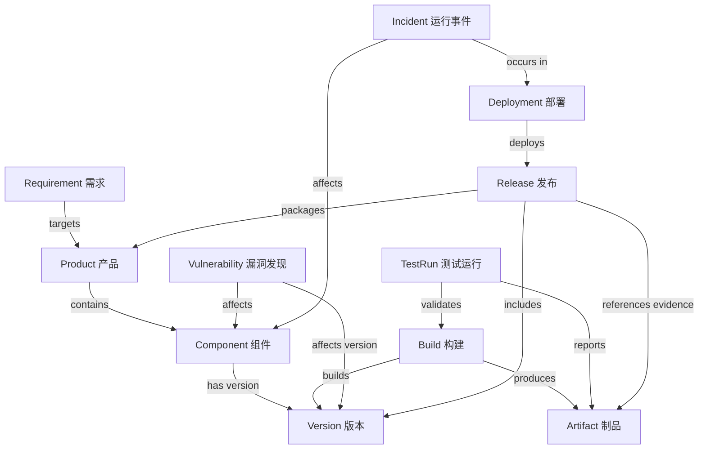

# 第 16 篇｜先建立共同语言：设计软件工厂的领域本体与机器可验证契约

> 「通往AI之桥」·《本体论在 AI 工程中的实践》系列
>
> **本篇目标：** 为 `ontology-software-factory` 建立第一版软件工厂领域本体、对象契约和跨对象语义校验，让后续 Agent 不再只靠自然语言“猜”任务含义。
>
> **阅读时间：** 约 15–20 分钟

---

## 01 为什么软件工厂不能只靠 Prompt 和 JSON？

在第 15 篇，我们为软件工厂划定了边界：它要接收结构化需求，选择经过审核的资产，组织开发、构建、测试与安全检查，并产出可追踪的软件交付物。现在要回答一个更基础的问题：这些环节所说的“需求”“组件”“版本”“构建成功”和“可发布”，是不是同一回事？

想象一下这条生产线：

- 需求 Agent 输出“需要支持高可用部署”，架构 Agent 把它理解为三个副本；
- 开发 Agent 提交了配置文件，认为任务已完成；
- 构建工具生成了制品，但测试 Agent 找不到对应的构建 ID；
- 安全 Agent 报告了一个高危漏洞，却没有说明它影响哪个组件版本；
- 发布 Agent 只看到一句“测试通过”，却拿不到测试运行记录和报告摘要。

这里未必是大模型“不够聪明”。真正的问题是：**各个环节没有共享、机器可检查的业务语义。** 一个 Agent 说“版本”，可能指组件版本；另一个指客户配置版本；第三个指代码提交。自然语言能够帮助解释，但不应成为跨系统传递关键状态的唯一载体。

本篇不打算一次性实现完整的软件工厂，而是先搭一组所有后续模块都必须遵守的约定：

1. 软件工厂有哪些核心业务对象？
2. 对象之间可以建立哪些关系？
3. 单个对象必须包含哪些字段、字段使用什么值？
4. 如何发现对象之间引用错误或业务状态矛盾？
5. 本体、Schema、业务规则、工作流和权限系统之间如何分工？

> **本篇交付目标：** 代码库中新增 `ontology/software-factory-ontology.json`、`contracts/schemas/entities.schema.json`、示例数据、校验模块和自动化测试。读者可以在本地运行验证命令，不需要先部署图数据库。

### 配图建议 1：从自然语言交接到语义契约

**建议位置：** 本节之后。

**图片生成提示词：**

> 生成一张适合微信公众号的 16:9 中文技术信息图，左侧展示多个 Agent 通过自然语言随意交接造成的歧义：版本含义不同、构建 ID 缺失、测试结果无证据、漏洞找不到影响组件；右侧展示统一领域本体和机器可验证契约：统一 ID、对象类型、状态枚举、关系引用、来源证据和版本号。用简洁的箭头对比“松散文本”与“结构化语义契约”，专业扁平化风格，白底，蓝绿为主色，不使用虚构数据或宣传数字。

---

## 02 先区分五件事：本体不是 Schema，也不是工作流

实践中，“本体”“数据模型”“JSON Schema”“规则”和“状态机”容易被混为一谈。它们相关，但负责不同的问题。

| 机制 | 它回答的问题 | 本项目中的落地方式 |
|---|---|---|
| **领域本体（Ontology）** | 业务世界里有哪些概念、它们如何关联？ | 软件工厂对象词汇、关系定义、状态与语义说明 |
| **对象 Schema** | 一个对象的结构是否合法？字段、类型和枚举是什么？ | JSON Schema Draft 2020-12 |
| **跨对象语义校验** | 引用是否存在、引用类型是否正确、关键业务不变量是否成立？ | Python 校验模块与自动化测试 |
| **状态机 / 工作流** | 对象可以按什么顺序改变状态，失败怎么处理？ | 第 19 篇再逐步实现状态机和工作流 |
| **权限 / 策略控制** | 谁可以读取、修改或执行什么动作？ | 第 20、22 篇接入 IAM、策略和运行时控制 |

本体定义“发布”是什么意思，却不会自动授权某个 Agent 发布；JSON Schema 可以要求 `status` 属于指定枚举，却无法单独证明测试记录确实来自真实测试工具；状态机可以限制发布顺序，但不能替代身份认证、密钥隔离和部署平台的访问控制。

这一区分非常重要。**语义正确不等于事实真实；结构有效不等于业务正确；业务正确也不等于有执行权限。**

对于当前 MVP，我们选择一种渐进式实现：以可读的 JSON 作为领域词汇表，以 JSON Schema 做对象层面的结构验证，以 Python 做跨对象引用与关键不变量校验。JSON Schema 官方规范将其定位为描述和校验 JSON 实例的语言；若未来需要对 RDF 图数据进行约束验证，可以引入 W3C SHACL；若需要形式化表达概念与逻辑语义，再考虑 OWL 2。它们不是必须一次性全部采用的“技术套餐”。

参考： [JSON Schema 2020-12](https://json-schema.org/draft/2020-12/)、[W3C SHACL](https://www.w3.org/TR/shacl/)、[OWL 2 概览](https://www.w3.org/TR/owl-overview/)。

---

## 03 第一版领域本体：从哪些业务对象开始？

软件工厂的核心不是“Agent 名单”，而是它生产和管理的软件资产与生命周期对象。第一版先覆盖 11 类对象。

| 类 / 对象 | 作用 | 关键关系 |
|---|---|---|
| `Requirement` 需求 | 记录需要解决什么问题、验收条件是什么 | 可指向目标 `Product`；应能追溯到验证证据 |
| `Product` 产品 | 标准软件产品或可交付产品族 | 由一个或多个 `Component` 构成 |
| `Component` 组件 | 中间件、服务、库、模板或工程工具 | 关联当前 `Version` |
| `Version` 版本 | 表达组件的一个可识别版本 | 归属于一个 `Component` |
| `Artifact` 制品 | 二进制包、容器镜像、配置包、报告、SBOM 或文档 | 可由 `Build` 生成，并被发布引用 |
| `Build` 构建 | 记录某次源代码和依赖构建的实际运行 | 关联组件、版本和制品 |
| `TestRun` 测试运行 | 记录一次真实测试执行及结果 | 关联 `Build` 和测试报告制品 |
| `Vulnerability` 漏洞发现 | 记录安全工具或审核产生的漏洞发现 | 指向受影响组件与版本 |
| `Release` 发布 | 组织某一产品版本的候选或正式交付 | 关联版本、构建、测试与安全证据 |
| `Deployment` 部署 | 记录发布物投放到某个环境的结果 | 指向一个 `Release` 和目标环境 |
| `Incident` 事件 / 故障 | 记录运行期异常、影响范围及处理进度 | 可关联部署、组件和证据 |

这些对象不意味着现在就必须为每一个类建设独立数据库表或 Agent。它们首先是**共享语义的边界**：让需求、代码、测试、发布与运维工具使用相同的业务术语和稳定标识。实现时可以将多个对象放在同一 JSON 文档、关系数据库表或事件流中；物理存储方式不是本体定义。

### 核心关系图



图中的 `targets`、`contains`、`produces` 等关系是领域语义；落地到不同系统时可以映射为外键、API 字段、事件引用或图边，但映射不能悄悄改变关系含义。

### 配图建议 2：软件工厂核心对象及关系图

**建议位置：** 核心关系图之后。

**图片生成提示词：**

> 绘制一张 16:9 中文软件工程领域本体关系图，中心对象为 Product 产品、Component 组件和 Version 版本；左侧连接 Requirement 需求；中部连接 Build 构建、Artifact 制品、TestRun 测试运行和 Vulnerability 漏洞发现；右侧连接 Release 发布、Deployment 部署和 Incident 运行事件。箭头需标注“包含、属于、构建生成、测试验证、影响、发布包含、部署、发生于”等准确关系。每个对象使用简洁矩形节点和清晰单向箭头，避免交叉线过多，白底、蓝灰与少量橙色强调，适用于技术文章，不添加虚构指标。

---

## 04 关系比实体列表更重要：要把语义定义到什么程度？

一张只包含实体的表格，还不足以形成可用的本体。真正能减少协作歧义的是关系的定义，以及哪些关系必须被验证。

| 关系 | 源对象 → 目标对象 | 工程含义 / MVP 校验 |
|---|---|---|
| `targetsProduct` | Requirement → Product | 需求面向哪个产品；目标对象必须存在 |
| `containsComponent` | Product → Component | 产品由哪些组件组成；目标必须是组件 |
| `hasVersion` | Component → Version | 组件当前或支持哪些版本；版本必须归属该组件 |
| `builtAs` | Build → Version | 构建针对哪个组件版本；组件与版本必须匹配 |
| `producesArtifact` | Build → Artifact | 该次构建生成哪些制品；制品需可被查询 |
| `validatesBuild` | TestRun → Build | 测试验证的是哪次构建，而不是“某个版本大概能用” |
| `affectsVersion` | Vulnerability → Version | 漏洞影响哪些版本，不能只记录一个不带范围的组件名称 |
| `packages` | Release → Product / Version | 发布所交付的产品与版本集合 |
| `deploysRelease` | Deployment → Release | 哪个发布物被部署到哪个环境 |
| `occursIn` | Incident → Deployment | 故障发生于哪个部署或运行环境 |

在实现上，我们将关系分为两层：

- **对象层字段约束：** `Build.versionId` 必须是非空字符串，`status` 必须属于允许的值。
- **图层引用约束：** `Build.versionId` 对应的对象必须存在，并且目标对象的类型必须为 `Version`；`Version.componentId` 必须与 `Build.componentId` 一致。

JSON Schema 擅长第一层；第二层需要读取一组对象后做跨对象校验。不要为了实现简单就把第二层省略，否则数据表面上合法，语义关系却可能完全错误。

---

## 05 给每个对象一份机器可校验的契约

本项目用 JSON Schema Draft 2020-12 定义对象结构。以 `Requirement` 为例：

```json
{
  "schemaVersion": "1.0.0",
  "ontologyVersion": "1.0.0",
  "tenantId": "demo-tenant",
  "id": "sf:requirement:REQ-001",
  "entityType": "Requirement",
  "name": "事件服务部署配置应支持多副本",
  "description": "为演示环境生成经过校验的配置，不直接部署生产环境。",
  "status": "approved",
  "priority": "p1",
  "acceptanceCriteria": [
    {
      "id": "AC-001",
      "description": "配置副本数不小于 3，且语法校验通过。",
      "verificationMethod": "integration",
      "required": true
    }
  ],
  "createdAt": "2026-10-27T08:00:00Z",
  "source": {
    "system": "demo-intake",
    "ref": "ticket:REQ-001",
    "recordedAt": "2026-10-27T08:00:00Z"
  }
}
```

这个对象除了业务字段，还带有一组贯穿全系统的治理元数据：

- `id`：跨 Agent、工具和存储系统保持稳定的对象标识；不能用对象名称代替。
- `entityType`：明确对象类型，避免把需求、产品和制品混为一类。
- `schemaVersion`：该 JSON 契约的版本。
- `ontologyVersion`：产生该对象时使用的领域语义版本。
- `tenantId`：多客户场景下的数据边界标识；它不替代授权检查。
- `createdAt` 与 `source`：记录时间和来源，支持追溯。

注意 `schemaVersion` 和 `ontologyVersion` 不是一回事。改动 JSON 必填字段可能是契约变更；改动“版本兼容”的业务含义则是语义变更。两者可能同时发生，也可能分别发生。

### 字段设计的实操规则

1. **ID 稳定，名称可变。** 产品展示名称可以改，但已经被构建记录引用的产品 ID 不应随之改变。
2. **状态集中定义。** 不让不同 Agent 各自创造 `done`、`complete`、`finished` 等近义状态。
3. **时间带时区。** 在 API 与日志中使用带时区的时间戳；不要把“昨天晚上”当作可机器比较的时间。
4. **关键结论必须指向证据。** “测试通过”应能追溯到 `TestRun`、报告制品、代码提交和构建 ID。
5. **来源和事实分开。** `source` 表示记录从哪里来，不自动证明来源内容真实；真实测试结果应来自受信任的执行器。
6. **不允许未知字段静默混入。** MVP 对核心对象采用严格校验。扩展字段应先通过契约版本演进，而不是让不同 Agent 随意添加字段。

---

## 06 单个对象合法还不够：跨对象语义校验

例如，一份 `Build` 记录通过了 JSON Schema 校验，字段齐全、类型正确，但它可能引用一个根本不存在的 `Version`；或者引用了另一个组件的版本。这种对象在结构上合法，在业务上却是错误的。

所以本项目引入第二层检查：

```python
# 逻辑示意；完整实现见 src/ontology_software_factory/semantics.py
expected_target_type = {
    ("Build", "versionId"): "Version",
    ("TestRun", "buildId"): "Build",
    ("Deployment", "releaseId"): "Release",
}

# 校验器会检查目标 ID 是否存在，以及目标实体类型是否正确。
```

当前代码库实现了以下类型的检查：

- **结构约束：** 必填字段、字段类型、枚举、日期时间格式与未知字段。
- **唯一性：** 同一对象集合内不允许重复 ID。
- **引用完整性：** 关系目标必须存在，并符合预期的实体类型；同一数据图中的引用不能跨越 tenantId 边界（这仍不替代授权）。
- **组件与版本一致性：** 构建所引用的版本必须属于该组件；产品发布所包含的版本必须来自产品声明的组件，漏洞影响的版本也必须属于对应组件。
- **状态不变量：** `Build` 标记为 `succeeded` 时必须引用构建产物；`TestRun` 标记为 `passed` 时，不得同时报告失败用例。

这些不变量是本示例项目的第一版约定，而不是适用于所有企业的普遍标准。真实工厂必须结合软件类型修改：例如纯 lint 任务可能没有发布制品，某些测试运行也可能只执行静态分析。规则应该服务于业务流程，而不是制造不必要的失败。

### 配图建议 3：两层校验流水线

**建议位置：** 本节之后。

**图片生成提示词：**

> 生成一张 16:9 中文工程流程信息图，标题为“软件工厂的两层语义校验”。第一层是 JSON Schema：字段、类型、必填项、枚举、时间格式、未知字段；第二层是跨对象语义：ID 是否存在、关系目标类型是否正确、组件与版本是否匹配、构建成功是否有制品、测试状态与失败数量是否一致。校验失败进入可定位的错误列表，不自动被模型忽略；通过后才进入后续工作流。采用清晰的两道质量闸门、蓝色和绿色状态，专业技术文档风格，不使用夸张百分比。

---

## 07 在代码库里如何落地？按下面步骤复现

第 15 篇的 starter 已经有 `ontology/`、`contracts/`、`src/`、`scripts/` 和 `tests/` 目录。本篇不另起一个新项目，而是往同一个仓库中增加本体和契约资产。

### 第一步：安装依赖

在项目根目录执行：

```bash
python -m pip install -e .
```

本篇将 `jsonschema` 加入项目依赖，用于按 Draft 2020-12 校验 JSON 对象。其余跨对象检查使用 Python 实现。

### 第二步：查看新增文件

```text
ontology/
  software-factory-ontology.json   # 类、关系、受控词汇与建模约定
contracts/
  schemas/entities.schema.json     # 11 类对象的结构契约
  examples/sample-entities.json    # 一组相互引用的演示对象
src/ontology_software_factory/
  contracts.py                     # JSON Schema 校验
  semantics.py                     # 跨对象语义校验
scripts/
  validate_domain_model.py         # 命令行验证入口
tests/
  test_contracts.py
  test_semantics.py
docs/
  domain-model.md                  # 设计说明、关系与演进约定
```

### 第三步：校验领域对象

```bash
python scripts/validate_domain_model.py
```

脚本会先检查词汇表中的类名唯一性及关系源/目标是否存在，再校验示例对象的结构与关系；通过时打印对象数量，失败时指出对象 ID、字段路径或关系目标并返回非零退出码，方便后续集成到 CI。

### 第四步：运行全部回归测试

```bash
python -m unittest discover -s tests -v
```

测试不仅包含一条成功路径，还故意构造了字段缺失、非法状态、重复 ID、悬空引用、错误目标类型和不合理状态组合等负向案例。**语义契约的价值不在于通过一份“漂亮的样例”，而在于能稳定地拦住错误数据。**

### 第五步：把契约纳入代码评审

本体文件、Schema 和语义校验代码必须一起评审。任何新增关系、调整状态枚举或修改必填字段，都应同时检查：

- 现有示例和历史数据是否仍有效；
- 哪些 Agent、工具和工作流依赖该字段；
- 是否需要升级 `schemaVersion` 或 `ontologyVersion`；
- 是否需要新增迁移脚本、兼容层和回归用例；
- 错误数据是否会绕过验证直接进入发布流程。

**不要让运行中的 Agent 自行修改正式本体。** 模型可以提出候选变更与测试，但正式变更应走代码审查、版本发布和兼容性验证。

---

## 08 现在要不要引入 RDF、OWL 和 SHACL？

我建议先解决实际问题，再决定是否升级表示方式。

| 选择 | 适用情况 | 当前项目建议 |
|---|---|---|
| JSON 领域目录 + JSON Schema + Python 校验 | 需要快速验证对象结构、ID、关系引用与业务不变量 | **本篇采用**，依赖少、容易进入 CI |
| RDF / OWL 2 | 需要形式化类、属性、逻辑语义、推理或与外部本体互操作 | 作为后续可选扩展；先明确能力问题 |
| SHACL | 已有 RDF 图，希望验证图数据是否满足节点、属性、基数和关系约束 | 在引入 RDF 图后评估；不是 JSON Schema 的简单替代品 |
| 关系数据库 / 图数据库 | 需要持久化、查询、事务或图遍历 | 存储选型独立于语义契约；本篇不要求部署数据库 |

不要误读这张表：JSON Schema 不能替代 OWL 的形式化语义；反过来，采用 OWL 也不会自动替你完成 API 字段验证、权限判断或生产状态机。不同工具解决的是不同层次的问题。

### 一个现实的升级路径

1. **阶段 A：** 本体词汇表 + JSON Schema + Python 语义校验，先跑通关键对象与引用。
2. **阶段 B：** 当跨产品、跨系统的语义互操作和复杂关系查询成为真实需求时，评估 RDF/OWL 与图存储。
3. **阶段 C：** 对 RDF 数据引入 SHACL 约束和验证报告；对 JSON/API 仍保留对应的 Schema 校验。
4. **阶段 D：** 建立映射与一致性测试，避免同一条业务规则在 JSON、图模型和工作流里各写一份、逐渐漂移。

---

## 09 风险清单：怎样避免本体变成新一层负担？

### 风险一：一开始就把所有业务概念都塞进本体

**表现：** 对象数量快速增长，字段复杂，业务团队无法评审，模型却没有明确的使用场景。

**应对：** 从关键交付链路里的 11 个对象开始；每个概念必须对应实际查询、校验、交接或审计需求。对没有被工作流消费的字段先不建模。

### 风险二：把数据表结构误当成业务语义

**表现：** 每个系统有一个 `status`，就试图做一对一字段映射；不同系统含义不同却强行统一。

**应对：** 先定义业务含义，再建立物理字段映射；遇到不能无损转换的概念，明确映射规则或保留源系统语义。

### 风险三：只校验 JSON，不校验关系

**表现：** 文档格式都合法，却引用不存在的构建、版本或测试报告。

**应对：** 将跨对象引用完整性和关键业务不变量纳入 CI，并以负向测试验证校验器是否真的能阻断错误。

### 风险四：本体版本和 Schema 版本混在一起

**表现：** 字段变化与业务含义变化没有记录，老版本 Agent 继续写入新语义的数据。

**应对：** 分开维护版本号，建立变更日志、兼容性声明、迁移和回归测试。破坏性变更应有明确的废弃窗口。

### 风险五：把“字段来自系统”误当成“事实可信”

**表现：** Agent 自己生成 `status: passed` 或填入一个看似合理的测试报告链接，就被发布流程采信。

**应对：** 对关键证据记录产生方、运行 ID、提交 ID、制品摘要、时间和可验证引用；发布门禁读取可信执行器的真实结果，而不是模型自述。

### 风险六：把本体当成权限系统

**表现：** 由于某个 Agent 知道 `Deployment` 的含义，就允许它创建生产部署。

**应对：** 本体描述对象和动作语义；IAM、策略引擎、工作流门禁和运行时沙箱负责授权与执行限制。后续第 20、22 篇会实现这些边界。

---

## 10 本篇验收清单

完成本篇后，至少应该能够回答“是”或“否”，而不是只凭感觉判断：

- [ ] 软件工厂的核心对象、关系和受控状态已经有机器可读定义。
- [ ] 核心对象有稳定 ID、对象类型、契约版本、语义版本和来源信息。
- [ ] JSON Schema 能阻止字段缺失、非法枚举、类型错误与未知字段。
- [ ] 语义校验能阻止重复 ID、悬空引用和错误目标类型。
- [ ] 关键关系能验证组件与版本的归属一致性。
- [ ] 构建与测试状态能通过明确的不变量检查。
- [ ] 正向和负向样例均有自动化测试。
- [ ] Schema 和本体的变更流程已进入代码评审。

本篇的成功标准不是“我们已经有一套完整的企业本体”，而是**后续开发的 Agent、Skills、工作流与工具适配层，开始共享同一组可机器验证的业务对象和关系约定**。

---

## 结语：本体不是画出来的，它要进入系统的执行路径

如果本体只是一张架构图，它更多是沟通材料；如果本体变成各 Agent 输入输出遵循的契约、跨系统引用共同使用的标识、状态验证和回归测试的一部分，它才开始成为工程资产。

接下来的第 17 篇，我们将把这些对象应用到软件资产管理：建立产品资产目录，管理中间件版本、配置模板、测试套件、来源、许可证、兼容关系和客户化配置，让工厂真正知道“可以复用什么、哪个版本可用，以及交付物从何而来”。

---

## 本轮架构补充：让 LLM 参与本体发现，但不让模型直接定义正式语义

上面的核心契约仍然是正式本体的基线。为了降低从文档、数据库字段和工程规范中发现概念的成本，我们再引入一条**候选本体发现流水线**。它不是取代领域专家，也不是把一段提示词直接保存为 `ontology.json`；它把 LLM 作为语义发现助手，输出可定位证据、可评测、可复核的候选。

### 候选发现的四个阶段

1. **术语发现**：从需求、配置、API Schema、SQL 字段说明、运行手册与事件样例中提出类、属性、状态、事件、动作和指标候选；每项要带来源引用与原文片段。
2. **关系发现**：在术语候选基础上提出关系、方向、基数/约束线索；不能仅因两个词共同出现，就断言二者存在业务关系。
3. **约束与能力问题发现**：提出结构、引用、状态不变量、兼容性约束，以及本体应能回答的 Competency Questions（能力问题）。约束输出是候选描述，不是可执行授权规则或任意代码。
4. **独立 Critic**：由不同角色、最好是独立模型配置检查术语重复、定义循环、关系端点缺失、证据不足和过度推断。随后由确定性校验器检查 JSON Schema、来源引用与图关系。

候选对象有独立 `candidateId`、源材料清单及 SHA-256、证据片段、模型调用轨迹、局部发现和评测结果。来源片段必须能够在原文中核实；引用不匹配或必需证据缺失时，候选不能进入评审通过状态。批准记录必须绑定候选内容摘要，避免批准后再悄悄更改候选。

### NVIDIA Auto Ontology、Cognee 与研究组件如何选

这些组件的定位不完全相同，应该通过适配器组合，而不是硬塞进核心模型：

- **NVIDIA Auto Ontology**：可作为企业元数据与语义目录的外部输入源。官方项目提供元数据/术语相关 API 与 MCP 等能力，但它是一套有自身服务、数据库和模型依赖的应用，不应假定它是一个可直接接收任意文本并输出我们正式领域本体的单函数。当前参考代码只做可选、只读的目录元数据适配。
- **Cognee**：更适合作为文档/知识图谱构建或自定义图模型的可选适配。发现候选先进入隔离的 `ontology-candidate-review-*` 暂存区，不写入生产图或正式语义注册表。
- **LLMs4OL / OLLM**：更适合作为本体学习方法与评测基线的研究参考。应把不同抽取算法作为候选生成器，使用同一份标注集比较，而不是仅按“生成了多少术语”选型。

参考：NVIDIA Auto Ontology（https://github.com/NVIDIA/auto-ontology；https://nvidia.github.io/auto-ontology/）、Cognee 自定义图模型（https://github.com/topoteretes/cognee）、LLMs4OL 研究线（https://arxiv.org/abs/2608.27101）。

### 本地如何复现

```bash
make ontology-discovery-config
make ontology-discovery-workflow
make demo-ontology-discovery
```

演示模式使用固定响应 Fixture，不访问外部模型。若需要真实调用，使用 `OPENAI_API_KEY` 与 `OPENAI_MODEL`，并可分别设置 `ONTOLOGY_TERM_MODEL`、`ONTOLOGY_RELATION_MODEL`、`ONTOLOGY_CONSTRAINT_MODEL`、`ONTOLOGY_CRITIC_MODEL`。不同阶段可以使用不同模型配置，但所有阶段遵守相同输出契约和预算策略。

**重要边界：** LLM 可以帮助发现、解释、归并和提出变更，但不能自行批准或发布本体。正式本体仍由领域专家/本体责任人评审，运行时授权也不能由本体里的某个字段代替。


## 参考资料与延伸阅读

1. **JSON Schema Draft 2020-12**：JSON 实例结构与约束验证规范。https://json-schema.org/draft/2020-12/
2. **JSON Schema Validation**：结构约束关键字的定义。https://json-schema.org/draft/2020-12/json-schema-validation.html
3. **W3C SHACL**：用于验证 RDF 图是否满足指定条件的约束语言。https://www.w3.org/TR/shacl/
4. **W3C OWL 2 Overview**：OWL 2 的概念、语义与本体文档概览。https://www.w3.org/TR/owl-overview/
5. **Python `jsonschema`**：JSON Schema 的 Python 实现与用法。https://python-jsonschema.readthedocs.io/en/stable/

> 规范链接核对日期：2026 年 10 月 27 日。不同实现对可选词汇（例如 `format`）的校验细节可能不同，生产环境应明确所用实现、版本与格式检查配置。

---

**「通往AI之桥」｜本体论在 AI 工程中的实践 · 第 16 篇**  
让业务语义成为机器可验证的契约，让软件工厂从共同语言开始。
