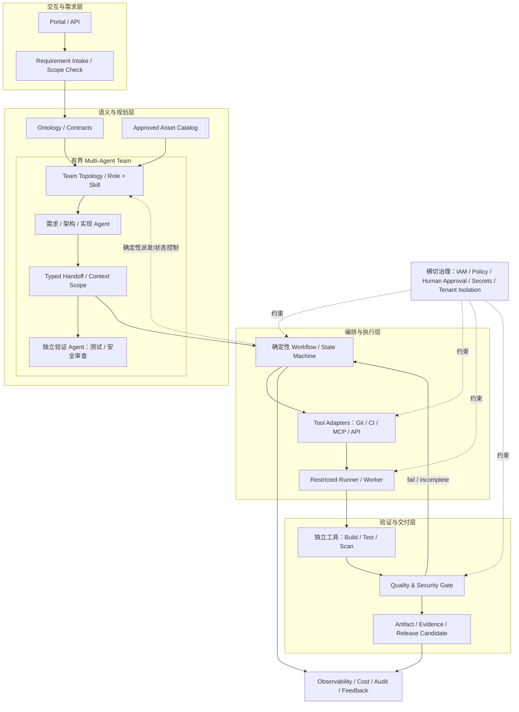

# 软件工厂总体架构（第 15 篇设计基线）

## 架构目标

围绕已批准 Kafka 版本的标准化/客户化配置交付，建立结构化需求、语义契约、资产选择、受控执行、质量门禁、候选交付与审计反馈的最小闭环。本文是目标架构，不代表各模块均已生产化实现。

## 系统上下文与逻辑分层

## 子系统细节

详见 `docs/subsystem-decomposition.md` 与机器可读 `config/architecture-baseline.json`。逻辑上分为：需求/交互、语义契约、资产目录、多智能体协作与 Agent 能力、工作流/任务、工具集成、受控执行、质量安全、交付发布、观测生命周期和横切治理。

## 多智能体核心设计

详见 `docs/multi-agent-architecture.md`，机器可读拓扑为 `agents/teams/software-factory-mvp.json`，跨 Agent 交接契约为 `contracts/schemas/agent-handoff.schema.json`。协作拓扑、上下文规则、并行汇合与修复循环上限是总体架构的一部分；不能等到写 Agent 代码时才临时决定。

## 稳定边界

1. 领域模型和 JSON 契约不依赖某个 Agent SDK。
2. 工作流状态机负责生产顺序，Agent 不能自行跳过状态。
3. 工具执行与权限决策分离；工具调用前必须有主体、动作、目标资源和上下文。
4. 配置生成、代码生成与真实验证分离。
5. 质量门禁只接受绑定到特定版本/制品摘要的真实报告。
6. 生产发布在 MVP 外；本地演练不得描述为真实集群部署。
7. 本体变更必须经过版本、兼容性分析、回归和批准。
8. 多智能体团队拓扑和交接契约显式版本化；Workflow 是确定性协调器，Agent 不自由改动生产顺序。

## 参考设计视图

- 项目范围：`docs/project-charter.md`, `docs/scope-and-nongoals.md`
- 分解：`docs/subsystem-decomposition.md`
- 本体：`docs/ontology-design-and-evolution.md`
- 原则：`docs/architecture-principles-and-constraints.md`
- 路线图：`docs/development-roadmap.md`
- 阶段验收：`docs/acceptance/architecture-baseline-checklist.md`

## 非功能、选型与风险

- 非功能要求：`docs/nonfunctional-requirements.md`
- 关键技术决策与替代方案：`docs/technology-decisions.md`
- 首版风险登记：`docs/risk-register.md`
