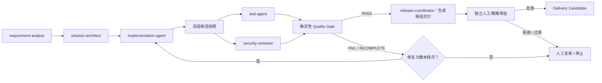

# 多智能体协作架构：软件工厂核心设计

## 1. 定位

多智能体协作不是 Agent 列表或开放式群聊，而是受控的团队拓扑：专业角色以契约交接任务，必要时并行收集独立证据，最终由确定性工作流和独立验证器决定是否进入下一阶段。

## 2. 三层职责必须分离

- **Agent/Skill 层（S4）**：定义角色责任、能力、输入输出、上下文范围和工具声明；团队拓扑描述谁与谁协作、怎样交接。
- **Workflow/Task 层（S5）**：拥有权威状态，执行派发、依赖、并行汇合、重试上限、暂停/取消和人工闸门；不是让 Agent 自行选择任意生产顺序。
- **Tool/Runner/Gate 层（S6–S8）**：实际执行工具与验证候选结果；权限决策独立于模型，Gate 只消费真实的版本化证据。

## 3. MVP 协作拓扑

`agents/teams/software-factory-mvp.json` 是可版本化拓扑；`contracts/schemas/agent-handoff.schema.json` 是跨 Agent 交接契约。图中顺序是目标协作模式，不表示每个 Agent/外部工具都已经生产化集成。

## 4. 协作模式

1. **顺序交接**：需求 → 架构 → 候选实现，前一阶段输出必须契约有效并满足后置条件。
2. **并行独立验证**：候选快照冻结后，测试与安全审查可并行；它们不可改写同一候选快照。
3. **All-required join**：所有必需的测试/安全证据齐全并符合策略后，Gate 才能给出 PASS；缺证据为 INCOMPLETE。
4. **有界修复循环**：MVP 最大修复循环为 2 次；耗尽后人工复核或停止。
5. **独立审批**：Release Coordinator 只准备候选包；批准人/策略服务不得与候选生成角色混同。

## 5. 权威状态、上下文与冲突

- Workflow Run Store 与事件账本是状态来源；Agent 私有会话不是权威记录。
- Agent 间传输不可变的对象/制品/证据引用，而不是复制一大段无版本上下文。
- 上下文分为已批准共享上下文、任务局部上下文、受限引用；秘密使用 secretRef。
- 真实工具证据与批准资产元数据优先于 Agent 自述；未解决的关键分歧必须升级人工。
- 任何 handoff 都需 `runId`、`taskId`、`attemptId`、发送/接收角色、输入引用、context scope、allowed tools、deadline、budget、acceptance criteria 与 failure policy。

## 6. 设计约束

- 不允许 Agent 自行增加角色、工具、预算或权限。
- 不允许 Agent 直接变更工作流状态；它只能返回候选结果/请求。
- 不允许同一个 Agent 生成并批准自己的高风险结果。
- 不将 Agent 共识/多数投票视为真实证据或发布授权。
- 并行度、跳数、修复循环、超时与费用必须有上限。
- 真实执行和质量通过取决于工具结果与证据，不取决于模型文本。

## 7. 领域本体的对应

软件交付核心本体保留 Requirement/Product/Component/Version/Artifact/Build/TestRun/Vulnerability/Release/Deployment/Incident。多智能体操作域通过扩展概念 AgentTeam、AgentRole、Skill、AgentTask、AgentHandoff、AgentResult、ContextReference、CoordinationDecision、ReviewDecision 描述协作运行，不把 IAM 授权塞进本体字段。

## 8. 验收

详见 `docs/acceptance/multi-agent-architecture-checklist.md`。自动检查覆盖角色引用、协调器性质、并行验证汇合、循环上限、交接必需字段和自审批阻断；真实 SDK/模型调用及企业 IAM 需单独进行集成验收。
