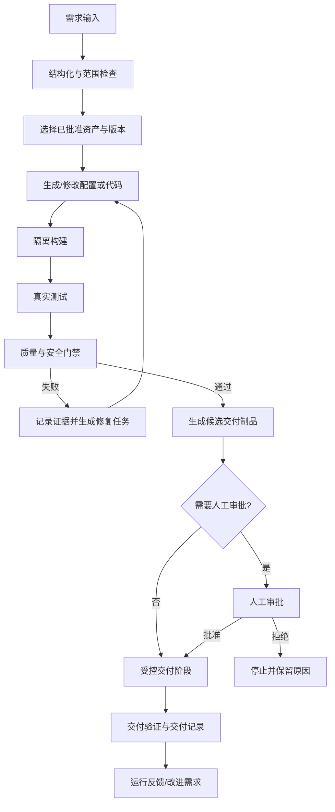

# 端到端流程：从需求到交付证据

## 关键控制点

1. 需求不清晰时，回到范围确认，不让 Agent 自行补出未经确认的业务约束。
2. 资产版本没有批准状态或来源信息时，不能进入生成阶段。
3. 构建/测试命令运行于隔离 runner，不能直接继承个人开发机或生产凭证。
4. 失败路径必须记录失败类别、证据和下一步动作；重试次数有上限。
5. 门禁结果绑定到正在评估的 commit 与制品摘要，不能拿旧报告证明新制品安全。
6. 生产执行权限由身份/策略系统控制，不能由 Agent 在对话中“申请后自动放行”。
